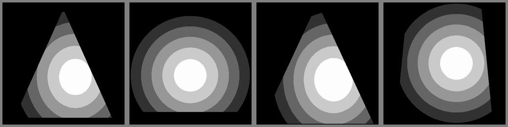
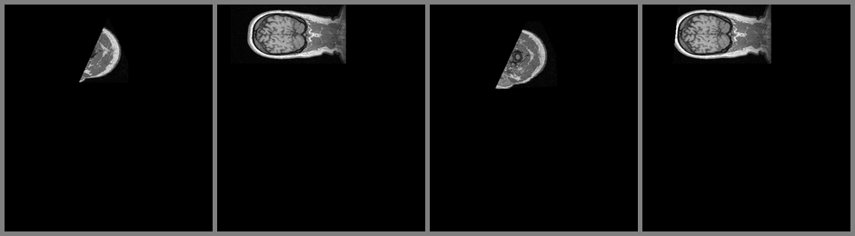
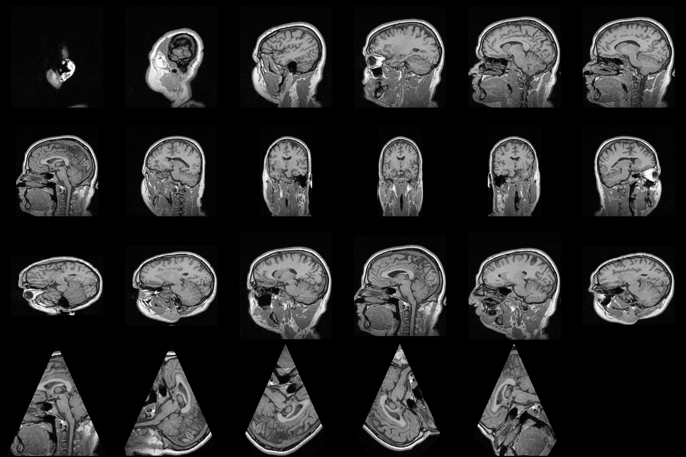
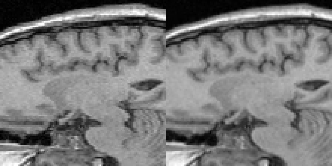
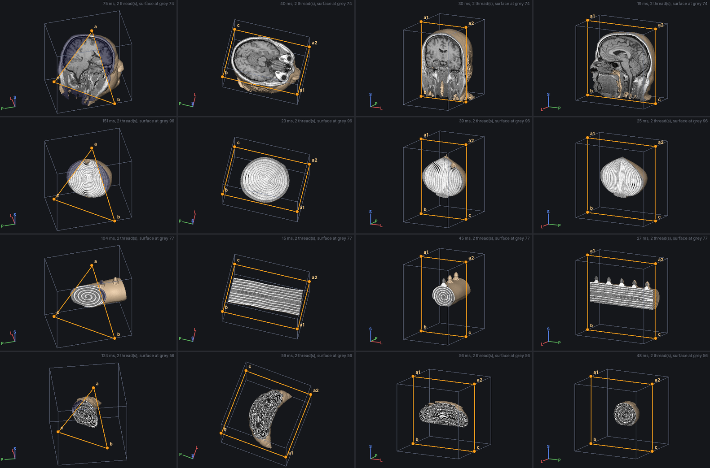
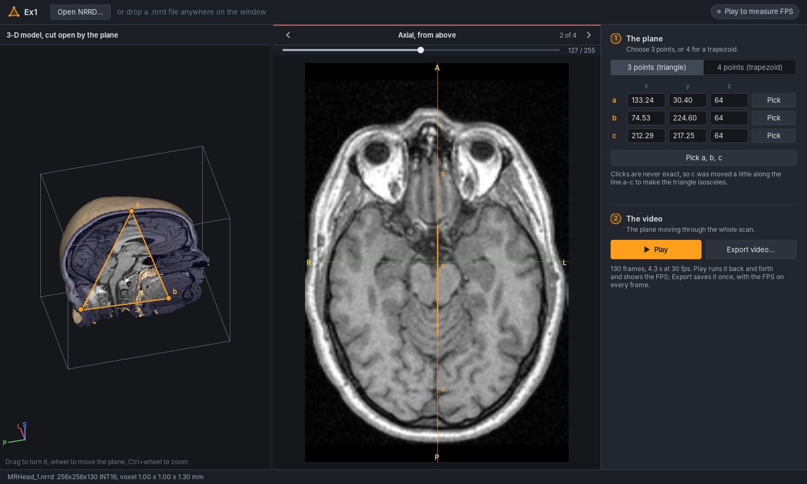
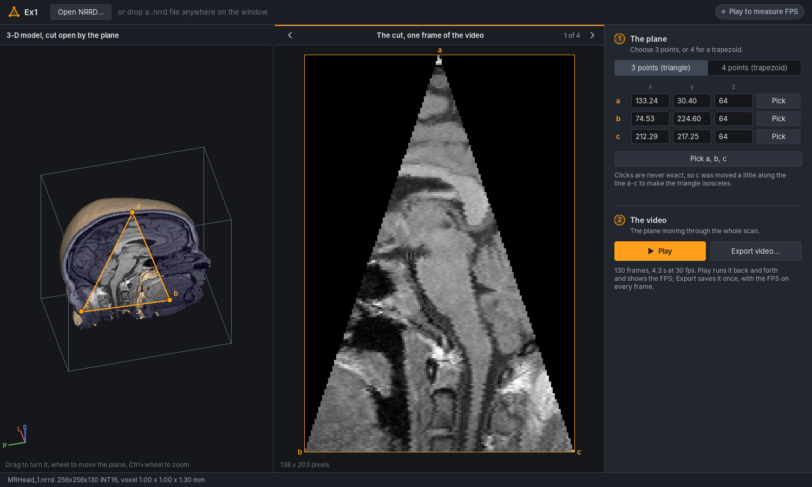
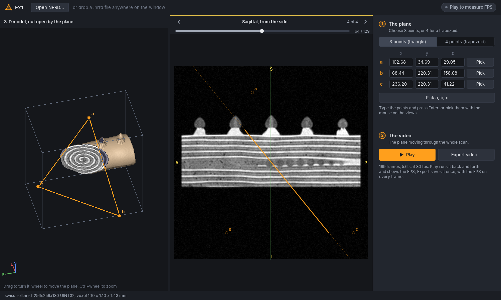
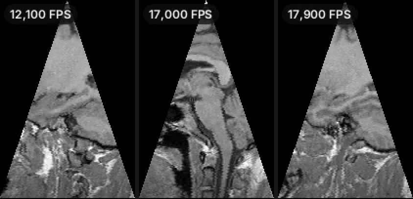

# Experiment and Results (To-Do item 8)

**Verifies:** NFR-01 (≥ 30 / 100 FPS), NFR-02 (threads), NFR-10 (3-D view), REQ-04…07 (the course's
and the lecturer's CSVs), REQ-17 (dataset), REQ-19/25/26 (the app on the lecturer's scans)
**Videos:** [`results/`](../results/) · **Reproduce:** `scripts/render_demo_videos.sh` (or `.bat`;
`LECTURER=<folder with his scans>` adds his use cases) and `java -cp build/Ex0.jar ex1.app.Benchmark N`

## 1. Setup

| Item | Value |
|------|-------|
| Machine | Cloud Linux VM, **2 vCPU** (shared, noisy), 7 GB RAM — deliberately a weak machine; a laptop is faster |
| JVM | OpenJDK 21, default flags (`-Xmx3g` only for the 1000³ volume and the croissant) |
| Timing | `System.nanoTime`; 100 warm-up frames, then 300 timed frames; file I/O and encoding excluded |
| Planes | 64 random oblique isosceles triangles with side ≈ N (large and oblique = the worst realistic case) |
| Threads | 1 (the requirement) and 2 (all cores of this VM) |
| Data | `data/` (MRHead, phantoms, the die), the lecturer's five scans and CSVs (his Drive folder; CSVs in `data/course/`) |

## 2. Performance (NFR-01: ≥ 30 FPS required, ≥ 100 FPS expected at 500³)

| Volume | Plane (px) | NN, 1 thread | TL, 1 thread | NN, 2 threads | TL, 2 threads | ns/pixel (NN, 1 thr) |
|-------:|-----------:|-------------:|-------------:|--------------:|--------------:|---------------------:|
| 100³ | 101×112 | 16 900 FPS | 4 489 | 9 512 | 5 600 | 5.3 |
| 250³ | 251×280 | 3 432 | 856 | 2 074 | 746 | 4.2 |
| **500³** | **501×560** | **281 – 436** | **110 – 136** | 372 – 456 | 149 – 167 | 8.2 – 12.7 |
| 1000³ | 1001×1119 | 98 | 27 | 97 | 36 | 9.2 |

Ranges at 500³ are from four runs on different days (the VM is shared; the latest, 3 Nov:
NN 353 / TL 136 / NN×2 456 / TL×2 167); the lowest value is the one to quote.

**Result:** at 500³, nearest neighbour runs at **≥ 280 FPS single-threaded** — 2.8× the
expected 100 FPS and 9× the required 30 — and trilinear also clears 100 FPS. Even the largest
allowed volume (~1000³) stays near 100 FPS with nearest neighbour. The lecturer's own 500³ scan
(the croissant, §4) runs his use case at 238 FPS.

**Observations**

1. *Cost per pixel rises with volume size* (4 → 9 → 13 ns) although the arithmetic is identical:
   a 100³ volume (1 MB) lives in cache, a 500³ one (125 MB) does not, and an oblique plane jumps
   across z-slices that are `sx·sy` bytes apart. The algorithm is `O(W·H)` as designed (EDD §4);
   what grows is cache misses per sample.
2. *Threads help the compute-bound path more than the memory-bound one on this VM.* Trilinear
   (≈ 26 ns of arithmetic per pixel) gains 1.2–1.35× with 2 threads; nearest neighbour is limited
   by memory bandwidth and gains little (even a loss at 100³, where a frame takes 60 µs and the
   hand-off to the pool costs more than it saves — the `ParallelProjector` keeps planes under 16
   rows on the calling thread for that reason). The output is bit-identical either way (TC-56),
   so the default stays at one thread and `--threads auto` is an opt-in.

## 3. The course's example CSV (`Ex0.csv`)

```
python Ex0.py data/phantom_spheres_500.nrrd data/Ex0.csv results/Ex0_phantom500.mp4
python Ex0.py data/MRHead.nrrd             data/Ex0.csv results/Ex0_MRHead.mp4
```

Console (both runs):

```
Warning : row 3 (line 4): side lengths differ: |ab| = 497.3932, |ac| = 476.8648 (must differ by < 0.001)
Warning : row 3 (line 4): drawn as given, with the algorithm's rails a1->b, a2->c
Volume  : phantom_spheres_500.nrrd 500x500x500 UINT8
Planes  : 4 from Ex0.csv
Frames  : 462x504 @ 10 fps, nearest, 1 thread(s)
```

Both videos have **exactly 4 frames** (`ffprobe`), one per CSV row, in order (REQ-07, TC-31).
Read in the course order (`a1, b, a2, c`, ADR-0004), rows 2 and 4 are valid without any note; only
row 3 is doubtful (drawn as given, warned).

**On the 500³ phantom** (the coordinates of `Ex0.csv` go up to 500, so this is the box they
describe). Left to right: row 1 isosceles triangle in the plane `y = 200`; row 2 the 401×501
rectangle `x = 200` (rails along `z`); row 3 the non-isosceles triangle — visibly lopsided, exactly
as its rails define it; row 4 the isosceles trapezoid, short base on top:



**On MRHead (256×256×130):** most of each plane lies outside the volume and is black ("if p is
NOT in M, v = 0"); the part inside shows the head:



*The FPS that `Ex0` prints for a 4-frame run (70–160) includes JIT warm-up of a cold JVM; the
steady-state figure is the benchmark in §2.*

## 4. The lecturer's test data

His Drive folder holds five scans, a use case for each, an `edge_cases.csv` and example images.
Every use case was rendered by the demo (`python Ex0.py <scan> data/course/<case>.csv out.mp4`):

| Scan | Size, type | Use case (rows) | What the planes do | Warnings | Frame | Projection, 1 thread | Video |
|------|-----------|-----------------|--------------------|---------:|------:|---------------------:|-------|
| `MRHead_1.nrrd` | 256×256×130, int16 | `head.csv` (280) | 131 slices `z = k`, 89 turning rectangles, 60 turning triangles | 0 | 256×256 | 216 ms (1 299 FPS) | `results/lecturer_head.mp4` |
| `onion.nrrd` | 256×256×130, uint8 | `onion.csv` (120) | two turns of 60 rectangles | 0 | 256×256 | 149 ms (806 FPS) | `results/lecturer_onion.mp4` |
| `swiss_roll.nrrd` | 256×256×130, uint32 | `swiss_roll.csv` (120) | two turns of 60 rectangles | 0 | 256×256 | 199 ms (604 FPS) | `results/lecturer_swiss_roll.mp4` |
| `biscuit_cake.nrrd` | 256×256×130, uint16 | `biscuit_cake.csv` (120) | two turns of 60 rectangles | 0 | 256×256 | 113 ms (1 067 FPS) | `results/lecturer_biscuit_cake.mp4` |
| `croissant.nrrd` | **500×500×500**, uint8 | `croissant.csv` (100) | 100 turning triangles | 0 | 502×560 | 420 ms (**238 FPS**) | `results/lecturer_croissant.mp4` |

All 640 rows read in the course order without a note; the `z = k` slices of `head.csv` come out
the right way up (rows along `y`), as in his images. (Our v3.0 read 4 points in the Q&A order and
would have transposed every rectangle — the reason for the revised ADR-0004.)

**Edge cases** — `python Ex0.py data/dice.nrrd data/course/edge_cases.csv results/edge_cases_dice.mp4`
on the die his file describes (200×180×160 uint32, cube 40…159 × 30…149 × 20…139 = 100 000, pips
= 200 000; `PhantomGenerator dice`):

```
Warning : row 7 (line 29): side lengths differ: |ab| = 188.7882, |ac| = 226.6319 (must differ by < 0.001)
Warning : row 7 (line 29): drawn as given, with the algorithm's rails a1->b, a2->c
Warning : row 8 (line 31): top a1a2 is not parallel to base bc (a2 is 16.0000 off the parallel through a1)
Warning : row 8 (line 31): drawn as given, with the algorithm's rails a1->b, a2->c
Warning : row 9 (line 35): the count says 4 points but 3 points are given -> black frame
Warning : row 10 (line 37): not a list of numbers: "3,99.5,0,139,0,179,139,199,179,abc,,," -> black frame
Warning : row 11 (line 39): not a list of numbers: "3,99.5,0,139,0,179,inf,199,179,139,,," -> black frame
Warning : row 12 (line 41): points b and c are the same point -> black frame
Warning : row 13 (line 43): points a, b, c are collinear (no plane) -> black frame
Warning : row 14 (line 45): the four points are not on one plane (c is 14.2780 from plane a1,a2,b) -> black frame
Warning : row 15 (line 47): the sides cross each other -> black frame
Warning : row 16 (line 49): the image would be 10200 pixels wide or high (limit 8192) -> black frame
Volume  : dice.nrrd 200x180x160 UINT32
Planes  : 16 from edge_cases.csv
Frames  : 280x280 @ 10 fps, nearest, 1 thread(s)
Projection: 16 frames in 11.9 ms (1342 fps, I/O excluded)
```

His expectation — *"16 frames; black: frames 6, 9 to 16; a warning for frames 7 to 16"* — is met
exactly, and frames 1–3 show the faces with 1, 6 and 4 pips (checked pixel by pixel in TC-38).
Frame 6 is black without a warning because it is a valid plane above the die.

## 5. Demo runs on MRHead with generated plane lists (`data/MRHead.nrrd`, 3D Slicer)

```
python Ex0.py data/MRHead.nrrd data/planes_<mode>.csv results/MRHead_<mode>.mp4
```

| CSV | Planes | Frame size | Projection time | Video |
|-----|-------:|-----------:|----------------:|-------|
| `planes_sweep.csv` (rectangles, z = 0…129) | 130 | 256×256 | 71 ms (1 820 FPS) | `results/MRHead_sweep.mp4` |
| `planes_rotate.csv` (0…180° around y) | 90 | 288×256 | 100 ms (896 FPS) | `results/MRHead_rotate.mp4` |
| `planes_tilt.csv` (−60…60° around x) | 90 | 256×288 | 74 ms (1 216 FPS) | `results/MRHead_tilt.mp4` |
| `planes_triangle.csv` (triangles, 0…360°) | 72 | 232×258 | 34 ms (2 101 FPS) | `results/MRHead_triangle.mp4` |
| `planes_tilt.csv`, `--interp trilinear` | 90 | 256×288 | 239 ms (376 FPS) | `results/MRHead_tilt_trilinear.mp4` |



*Rows: sweep (sagittal slices), rotate (sagittal → coronal), tilt, rotating triangles — the
triangle row shows the exact shape the course algorithm defines.*

## 6. Synthetic dataset (phantoms with known answers)

| File | Type | Content | Expected cross-section | Seen |
|------|------|---------|------------------------|------|
| `phantom_spheres_u8.nrrd` | uint8 | nested balls | concentric rings at **every** angle | ✔ |
| `phantom_checker_u16.nrrd` | uint16 | 16³ checkerboard | squares when axis-aligned, stretched stripes when rotated | ✔ |
| `phantom_gradient_u32.nrrd` | uint32 (values up to 4·10⁹) | `x + y + z` ramp | smooth diagonal ramp | ✔ |
| `dice.nrrd` | uint32, 3 values | the lecturer's die | faces with 1, 6, 4 pips (§4) | ✔ |


## 7. Nearest neighbour vs trilinear

Nearest neighbour shows stair-step edges on oblique planes (each pixel snaps to one voxel);
trilinear is visibly smoother at ~3× the cost. Both meet the target at 500³, so trilinear is a
free quality upgrade when there is FPS headroom.



## 8. The app on the lecturer's scans

**What it shows.** Each scan is turned into a solid (ADR-0009) and cut open by the plane: the half
between the viewer and the plane is removed, so the cut face shows the inside of the object —
the brain inside the skull, the onion's rings, the swiss roll's spiral, the croissant's layers —
next to the shaded outside. Rows: head, onion, swiss roll, croissant; columns: the default
triangle `a, b, c`, then the plane of the **Axial**, **Coronal** and **Sagittal** slice (v3.1 had
buttons for these; since v3.3 the plane comes from its points only, ADR-0012):



The whole window (v3.4, ADR-0014: the app's own dark look) — the head after three picked points,
the picture panel turned to **Axial** (picture 2 of 4): the 3-D view (left), the axial slice with
the plane's line (middle; its arrows flip to Coronal, Sagittal and back to the cut), the points and
the video (right); top right the FPS, which says *Play to measure FPS* until the video plays:



**Choosing a cut by 3 points** (Robot script on a virtual display, the steps of TESTING B.11):
*Pick a, b, c* (the picture panel turns to Axial; two arrows on to Sagittal) → `a` clicked on the
top of the head, `b` at the jaw and `c` at the back of the neck → the app says "Clicks are never
exact, so c was moved a little along the line a-c to make the triangle isosceles", cuts the head
there and turns the camera to the cut: the brain and the brain stem show on the cut face, and on
the cut (picture 1) as the video frame:



The swiss roll with the picture panel on **Sagittal** (picture 4 of 4) — the roll seen lengthwise,
with the default triangle's line; the 3-D view shows the spiral on the cut face:



**Timings** (the 2-vCPU VM; `ModelTiming` harness, renders after warm-up, 520×340 view):

| Scan | Load | Solid model (size) | Default surface | 3-D frame, 1 thread | 3-D frame, 2 threads | Half resolution, 2 threads |
|------|-----:|-------------------:|----------------:|--------------------:|---------------------:|---------------------------:|
| MRHead_1 256×256×130 | 87 ms | 0.85 s (full) | grey 74 | 27 ms | 14 ms | 4 ms |
| onion 256×256×130 | 52 ms | 0.92 s | 96 | 40 ms | 19 ms | 6 ms |
| swiss_roll 256×256×130 | 162 ms | 0.74 s | 77 | 35 ms | 18 ms | 5 ms |
| biscuit_cake 256×256×130 | 95 ms | 0.55 s | 77 | 24 ms | 14 ms | 4 ms |
| croissant 500×500×500 | 708 ms | 2.62 s (250³) | 56 | 53 ms | 26 ms | 7 ms |

So the 3-D view redraws at 140–250 FPS at half resolution while the user drags, and sharpens to
38–70 FPS full frames (NFR-10: ≥ 10 FPS while moving, sharp within 0.5 s — met with a wide
margin). The first frame after loading is slower (75–150 ms, shown by v3.1's 3-D view, which printed its
frame time) because the JIT has not compiled the ray loop yet. The 2-D cut costs 1–10 ms as before.

**The lecturer's use cases** go through the command line since v3.3 (ADR-0012): `Ex0 MRHead_1.nrrd
head.csv x.mp4` gives his 280 frames (v3.2 also loaded them in the app and its export matched
`Ex0` byte for byte; an earlier export differed in one frame because the writer rounded to 6
decimals — the writer now prints exact numbers, ADR-0008, TC-48).

**The app's video** is the chosen plane swept through the scan (ADR-0011), at 30 fps since v3.4
(ADR-0014). On MRHead the default triangle gives 169 frames, 5.6 s; the picked triangle above 130
frames, 4.3 s; *Play* starts at the current plane and turns at both ends ("frame 85 of 130" under
the cut below); *Export video…* → Enter wrote `MRHead_1_cut.mp4` (30 fps, one frame per step by
`ffprobe`, 138 × 204), and a second export proposed `MRHead_1_cut_2.mp4`. (v3.3 at 10 fps: 169
frames, 17 s; a 4-point trapezoid in the axial slice 127 frames, 80×152.)

**Export on a PC with a broken ffmpeg** (ADR-0012). Under Wine with the bundled Windows runtime
and a fake `ffmpeg.exe` on the PATH that lists `libx264` but fails ("Unknown encoder
'libx264'") — the kind of copy that made v3.2's export fail: the CLI printed "Warning : ffmpeg
stopped accepting frames: Unknown encoder 'libx264' - writing the video with the built-in
encoder instead" and wrote the edge-case video (16 frames); the app saved 169 frames and said
"The ffmpeg on this computer did not work, so the app's own encoder made the video". Without any
ffmpeg the built-in writer is used from the start (169 frames, 12.7 MB).


**The FPS while playing and in the video** (v3.4, ADR-0014; the 2-vCPU VM, Robot on Xvfb). The
number is the projection's speed for the frames being made — nearest neighbour, one thread, the
median of the last 15 frames — and appears only then: in the toolbar and on the cut while Play runs,
and in the corner of every exported frame. It follows what the cut goes through:

| Scan, plane | Cut | While playing | Export: the run's median (3 runs) | Note |
|-------------|-----|--------------:|----------------------------------:|------|
| MRHead_1, default triangle (oblique) | 205 × 229 | 2 290 – 2 400 FPS in the head, ~10 000 in air | 3 240 (cold JVM), 6 380 – 6 450 | an oblique plane walks across slices: cache misses |
| MRHead_1, picked triangle (`z` constant) | 138 × 203 | 8 570 – 9 290 | 12 600 – 19 000 | one slice per frame: the reads stay in cache |
| croissant 500³, default triangle | 400 × 448 | 660 – 700 | 687 (cold), 910 – 916 | the size of the assignment's requirement: 6.6 – 9 × its "≥ 100" |
| `Ex0.csv` on MRHead (command line) | 462 × 504 frames | — | labels 370 – 974 (4 frames) | prints "4 frames in 8.2 ms (490 fps)" |

(The export's column is the same code as *Export video…*, run three times in one JVM by a small
harness; the first run includes the Java compiler warming up the projection.)

Frames through air are cheaper (a bounds check, no read), so the number rises at the ends of a
sweep; it is a true value, not noise. While playing it is a little lower than in an export: the
3-D view draws on the other core at the same time.



**A window that never waits** (v3.4). The 3-D view now draws on a thread of its own; the window
only copies its last finished frame. With Play running, dragging the 3-D view for 2.4 s moved the
video from frame 99 to 163 (≈ 27 fps including the screenshots' own time), and the next second at
the full 30 fps; before, every Play frame waited for a 3-D frame on the Swing thread (9–55 ms at half
resolution, 37–209 ms sharp for 0.45–1.8 megapixels on this VM).

## 9. Other observations

1. **Anisotropic voxels (EDD D10).** MRHead has 1.3 mm spacing on one axis. The projection
   measures distances in voxel units, as the assignment defines, so a coronal video frame looks
   ~23 % narrower than reality; the app's 3-D and slice views use the spacing and look right.
2. **Course algorithm's off-by-one (EDD D1).** Implemented literally, step 5a skips the apex row
   and never reaches `b`. We sample rows `0 … floor(Dab)`, so both ends appear (TC-53).
3. **Global window (ADR-0006).** One window per video avoids brightness flicker between frames;
   the 0.5/99.5 % percentiles ignore the few very bright voxels. The die has only three values,
   where percentiles would map the pips (≈ 3 % of the cube) to the same white as the cube — hence
   the `[min, max]` rule for ≤ 16 grey levels.
4. **Built-in MP4 size (ADR-0005).** `Ex0_MRHead.mp4` is 20 KB with ffmpeg and ~1.5 MB with the
   built-in lossless writer; the 130-frame sweep grows from 1.8 MB to ~13 MB. Acceptable for a
   demo; ffmpeg is picked up automatically when installed.
5. **Thresholds of the solid (ADR-0009).** Otsu's split gave a clean object on all five scans; the
   croissant's crust is thin and its default surface (grey 56) is the lowest. Lowering the
   Surface slider brings back scanner noise as floating specks, raising it thins the skin — the
   cut face does not depend on it.

## 10. Future work
* GPU (CUDA) version — the course's Ex5 option 5.1; the row structure maps directly to a 2-D kernel.
* Physical (mm) coordinates in the CSV (opt-in), from `space origin` / `space directions`.
* Android front end reusing `core`, `PlaneSpec`, `SolidModel`, `CutawayRenderer` and `Raster`
  unchanged (picking points by touch).
* A smoother surface for large scans: model at full resolution with a coarse-to-fine ray march.
