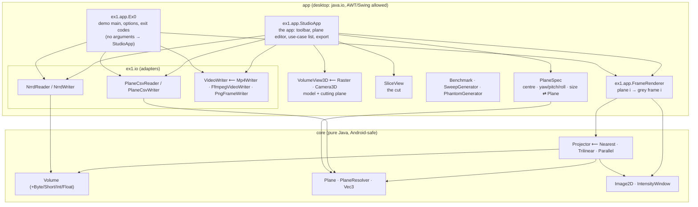
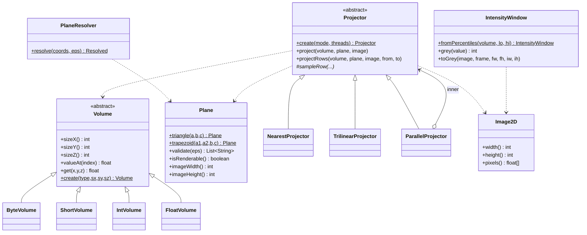
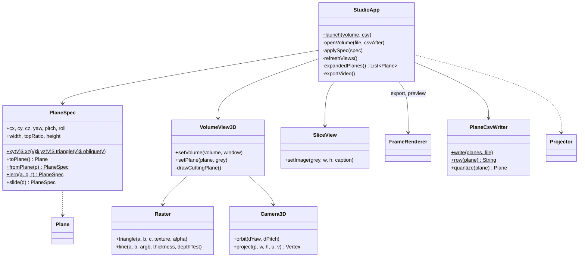
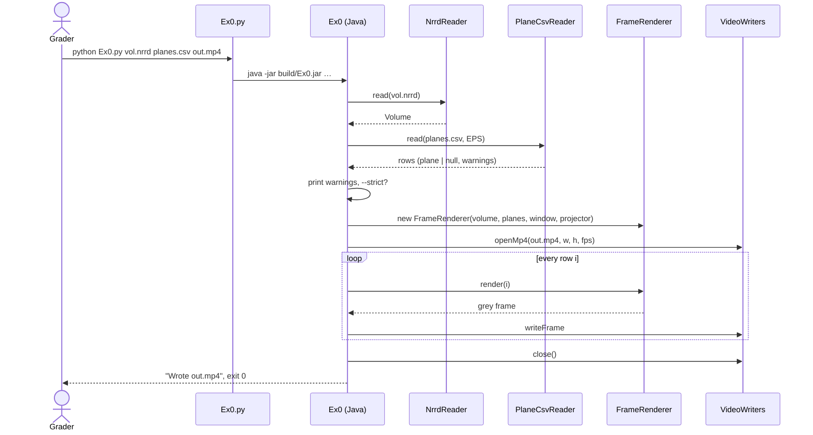
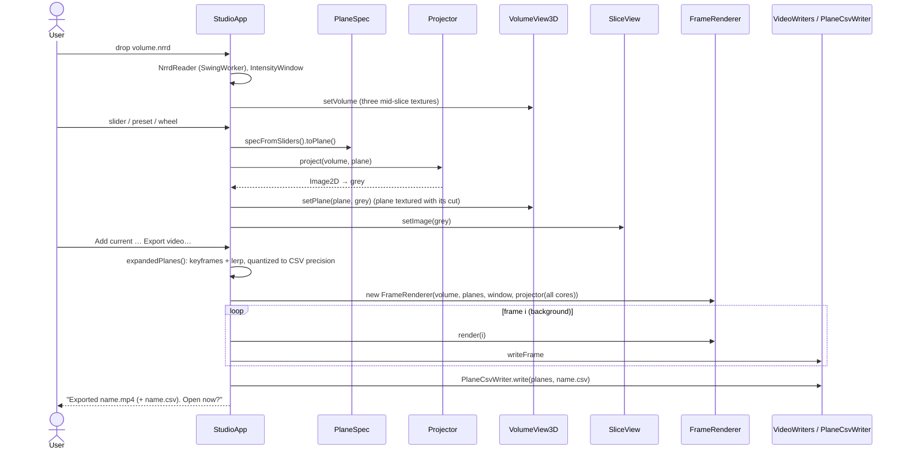

# Software Design Document (SDD)

**Project:** Ex1 — Plane Projection of a 3D Volume · **Version:** 3.0 (adds the app: §3, §4.1, §5.1, ADR-0008)
**Answers:** how is the system structured, and what did we reject?
**Inputs:** [SRS](SRS.md) · **Details per component:** [ALGORITHM.md](ALGORITHM.md) (EDD of the projection) ·
**Decisions:** [ADRs](adr/)

---

## 1. Context and goals

One library computes plane projections of a 3-D volume fast enough for interactive use; two thin
front ends use it: **the app** (cut a model with a plane you place on it, see the cut, collect the
planes of a use case, export its video) and the command-line demo required by the assignment. Goals,
in order: correct and robust on any input (SRS REQ-07, NFR-04) · ≥ 30 FPS single-threaded on 500³
(NFR-01) · readable, tested, explainable code · reusable on Android later.

**Non-goals:** physical coordinates, colour volumes, GPU, networking.

## 2. Context diagram (C4 level 1)

```mermaid
flowchart LR
    student([Student / course staff]) -->|"double-click, drag & drop, sliders"| sys
    grader([Course staff]) -->|"python Ex0.py nrrd csv mp4"| sys
    subgraph sys[Ex1 Plane Projection]
      direction LR
      gui[The app: StudioApp]
      cli[Ex0 demo CLI]
    end
    slicer[(3D Slicer sample data)] -. MRHead.nrrd .-> sys
    ffmpeg[ffmpeg, optional] <-. smaller MP4 .-> sys
    sys --> player([Any video player])
```

## 3. Containers and components (C4 levels 2–3)

Two Gradle modules, one runnable jar.



**Dependency rule:** `core` knows nothing about files, pixels formats or the UI; `app` depends on
`core`, never the other way round ([ADR-0002](adr/0002-core-app-split.md)). This is the "ports and
adapters" split from the course modules: `VideoWriter` is a port, the three writers are adapters.

### 3.1 Responsibilities

| Component | Responsibility | Key design choice |
|-----------|----------------|-------------------|
| `Volume` + subclasses | Hold `M` at native sample width; `valueAt(i)` returns a float | One abstract class, four typed arrays: 8-bit volume = 1 byte/voxel (NFR-03) |
| `Plane` | The trapezoid `(a1, a2, b, c)`; triangle = `a1 == a2`; validation (REQ-06); image size | One shape for the whole pipeline |
| `PlaneResolver` | Turn raw CSV points into the plane to project (REQ-05) | Documented order first, alternatives only when it is invalid |
| `Projector` | Template method: walk rows, centre each row, delegate sampling | Rows are independent → trivially parallel |
| `NearestProjector`, `TrilinearProjector` | `sampleRow(...)` | Inner loop: 3 adds + bounds check + 1 read |
| `ParallelProjector` | Decorator: splits rows across a fixed thread pool | Bit-identical output (NFR-05) |
| `IntensityWindow` | Global percentile window → 8-bit grey (REQ-12) | Computed once per volume |
| `Image2D` | `float[]` result buffer, reused between frames | No per-frame allocation |
| `NrrdReader` | NRRD header + raw/gzip data → `Volume` | Streams 1 MB chunks straight into the typed array |
| `PlaneCsvReader` | CSV → list of rows (plane or null + warnings) | One entry per data row, never aborts on a bad row |
| `PlaneCsvWriter` | Planes → CSV in the course format; `quantize` = the plane exactly as the CSV reads back | 6 decimals, so EPS rules survive the round trip; the app renders quantized planes, hence video ≡ demo(CSV) |
| `VideoWriter` family | Frames → MP4 / PNG | Built-in encoder as the always-works path |
| `FrameRenderer` | Plane *i* → grey frame *i*, common frame size | Shared by CLI and GUI, so both produce identical frames |
| `Ex0` | Argument parsing, exit codes, orchestration | Pipeline reads top-down |
| `StudioApp` | The app: toolbar, two views, plane editor, use-case list, playback, export | Swing only; projection on every change (≈ 1–10 ms); export on a `SwingWorker` through `FrameRenderer` |
| `PlaneSpec` | The *editable* form of a plane: centre, yaw/pitch/roll, width, height, top ratio; `toPlane()`, `fromPlane()`, `lerp()`, presets | Every spec is a valid isosceles plane by construction; sliders cannot produce an invalid plane; interpolation is in this space ([ADR-0008](adr/0008-plane-spec-and-software-renderer.md)) |
| `VolumeView3D` | The model: bounding box, axes, three mid-slices, the cutting plane textured with its own cut (strips mapped to the projection rows); orbit / zoom / slide | Draws through `Raster`, no OpenGL |
| `Raster`, `Camera3D` | Software z-buffer rasterizer (textured and solid triangles, depth-tested lines) and an orthographic orbit camera | ~400 lines, JDK only, Android-portable (`int[]` ARGB) |
| `SliceView` | The cut as a 2-D image with caption | Fits the panel, keeps the frame's aspect |

## 4. Class diagram (C4 level 4, core)



### 4.1 Class diagram — the app



Why a second representation of a plane: the sheet's 3 or 4 points are the interface to files and
to the algorithm, but they are a poor thing to *edit* — moving one point breaks the isosceles rule.
`PlaneSpec` is the user's view (where, which way, how big); the conversion to points is one
place, tested (TC-80…TC-85), and the inverse exists so a CSV row loads back into the sliders.

## 5. Key flow: UC-01 demo (sequence)



### 5.1 Key flow: UC-02 / UC-05 — cut, then export (sequence)



## 6. Data

| Data | Representation | Why |
|------|----------------|-----|
| Volume | flat typed array, `index = x + sx·(y + sy·z)` | NRRD on-disk order: no reshuffle on load; x-fastest matches the inner loop |
| Plane | four `Vec3` (doubles) | fractional coordinates allowed by the CSV |
| Plane, while editing | `PlaneSpec` (9 doubles) | always valid; the only form the sliders and the interpolation touch |
| Model view | three grey mid-slices as ARGB textures; the cut as one more texture, tinted orange | the user sees the cut *on* the plane and as an image at the same time |
| Projection | `float[]` `W×H` | holds any voxel type without loss before windowing |
| Frame | `byte[]` grey, `W×H` even | what both MP4 writers and PNG need |
| Video | H.264 in MP4 | REQ-14; the built-in writer uses I_PCM macroblocks (lossless, large), ffmpeg uses x264 (small) |

## 7. Deployment

* **Desktop:** one jar `build/Ex0.jar` (built by `scripts/build.*`, `Ex0.py`, or Gradle); launched
  by `Ex0.py` / `Ex0.bat` / `Ex1 Viewer.bat`, which locate a JDK (IntelliJ `.jdks`, Android Studio
  `jbr`, `JAVA_HOME`, `PATH`).
* **CI:** GitHub Actions, matrix {ubuntu, windows} × {JDK 17, 21}: build with `-Werror`, 76 unit
  tests, the demo command on the course CSV, a strict-mode failure check, and a 500³ benchmark
  gate (≥ 30 FPS).
* **Android (future):** `core` compiles unchanged (no `java.io.File`, no AWT); the app would add a
  `MediaCodec` `VideoWriter` and a `ContentResolver`-based NRRD source.

## 8. Rationale and alternatives considered

| Decision | Chosen | Rejected | Why | ADR |
|----------|--------|----------|-----|-----|
| Language | Java 17 + Python launcher | Python/NumPy, C++ | 300+ FPS is realistic in Java; team plans an Android port; the launcher keeps the sheet's `python Ex0.py` form | [0001](adr/0001-java-with-python-launcher.md) |
| Module split | `core` / `app` | single module | Android reuse, testability of the algorithm without I/O | [0002](adr/0002-core-app-split.md) |
| Bad CSV rows | warn + project / black frame; `--strict` to abort | abort on first error; silently skip | item 7c: frame per row in order; the course's own file has invalid rows | [0003](adr/0003-invalid-rows-policy.md) |
| 4-point order | documented order, else rails reading | fixed order only | course `Ex0.csv` row 4 is only valid as rails | [0004](adr/0004-csv-point-order.md) |
| Video | built-in I_PCM H.264 writer + optional ffmpeg | ffmpeg only; JCodec | no install step for the grader; no third-party jars (offline build) | [0005](adr/0005-built-in-mp4-writer.md) |
| Grey mapping | one percentile window per video | per-frame min/max | no flicker; outliers ignored | [0006](adr/0006-global-intensity-window.md) |
| Parallelism | row blocks on a fixed pool, default 1 thread | always all cores; per-pixel tasks | requirement is single-threaded; rows independent → identical output | [0007](adr/0007-row-parallelism.md) |
| App: plane editing and 3-D view | `PlaneSpec` (centre + angles + size) and a software z-buffer in Swing | editing the 3/4 points directly; JavaFX 3D / JOGL / a volume-rendering library | points break the isosceles rule when moved; JavaFX is not in the JDK any more and OpenGL means native jars — a 400-line rasterizer runs everywhere and ports to Android | [0008](adr/0008-plane-spec-and-software-renderer.md) |

## 9. Risks and trade-offs

| Risk | Impact | Mitigation |
|------|--------|------------|
| Grader's machine has no Java | demo does not run | launcher prints a clear message with the download link; README quick start; CI proves it on clean Windows/Linux images |
| Built-in MP4 files are large (~1.5 B/pixel/frame) | a 500-frame 500² video ≈ 190 MB | ffmpeg path used automatically when present; `--fps`/frame count under user control; documented |
| Anisotropic voxels (MRHead 1.3 mm on one axis) | images slightly stretched | out of scope by the assignment's definition; listed as future work |
| Course algorithm ambiguities | grader expects a different pixel-level convention | every choice documented (EDD §5) and configurable where cheap |
| Memory for 1000³ volumes | 1 GB heap | `-Xmx2g` in launchers; chunked loader; clear OOM message |
| The model view is slices, not a surface | a user may expect a rendered head | the cutting plane itself is textured with its cut, which is what the exercise is about; "Model slices" can be hidden; ray casting is listed as future work |
| Swing look differs per OS | screenshots differ from the user's screen | layout uses only standard components and sizes; checked on Windows 11 and Linux |

## 10. Open questions
* Should the apex row (`y = 0`) be sampled? The sheet's loop starts after one step; we include it
  (EDD D1). Either reading differs by one row.
* Orientation of 4-point rectangles: both `(a1,a2,b,c)` and the rails reading are valid; we keep
  the documented order, which transposes the image relative to the rails reading.
