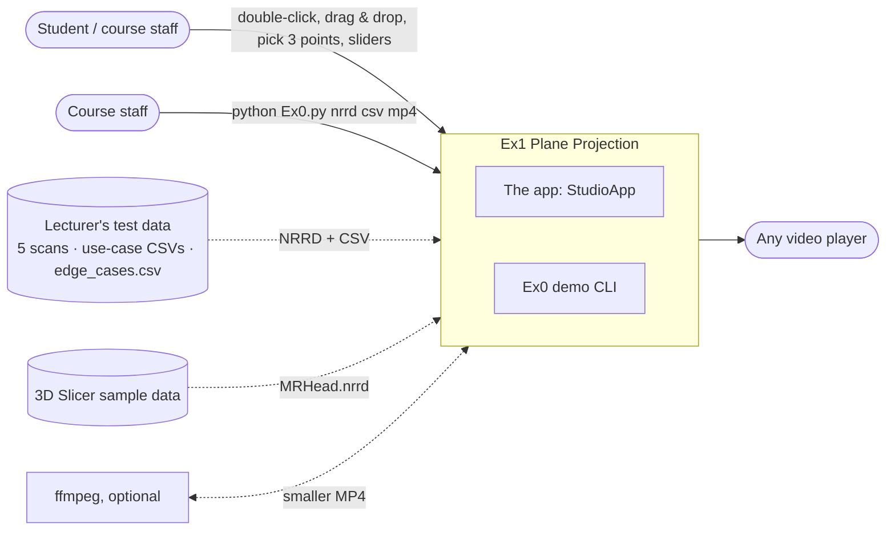
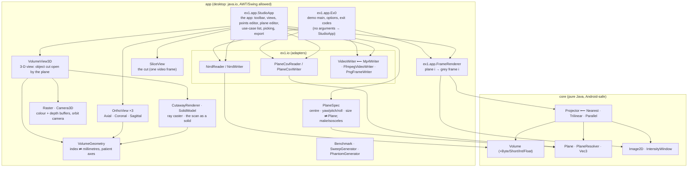
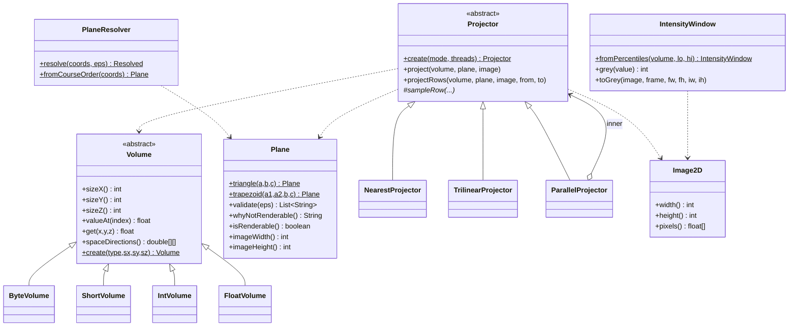
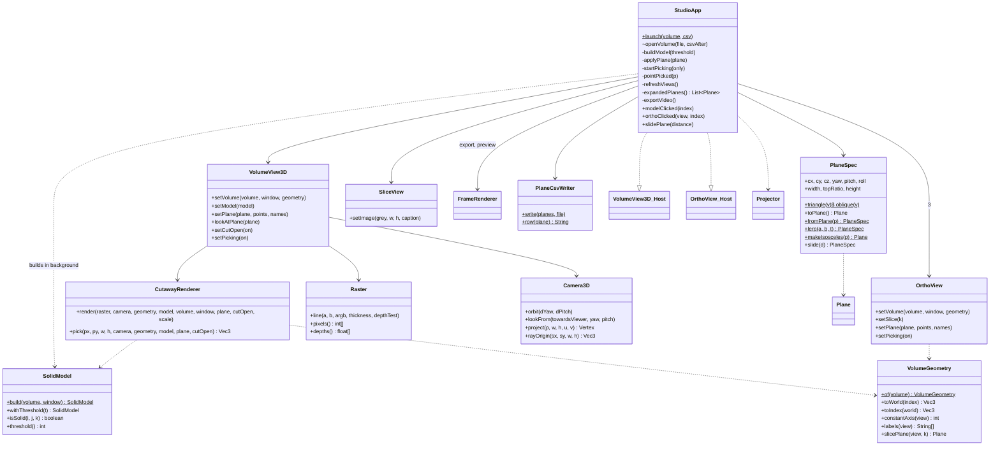
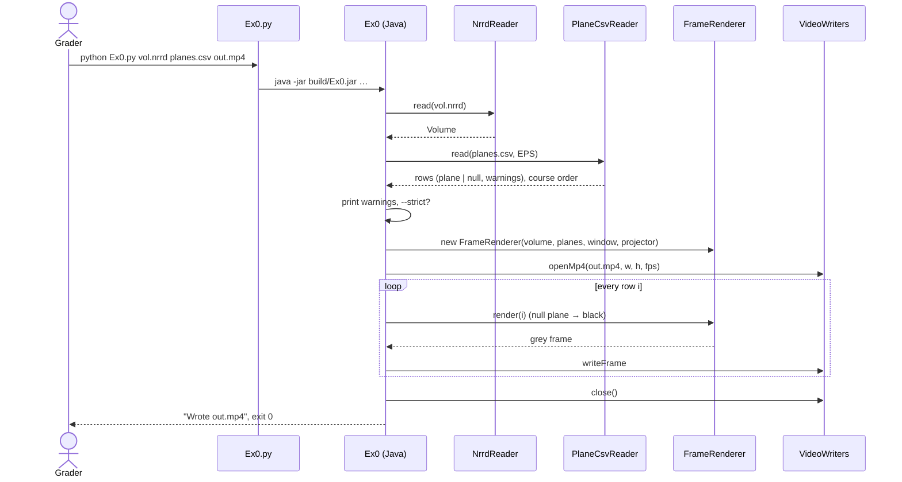
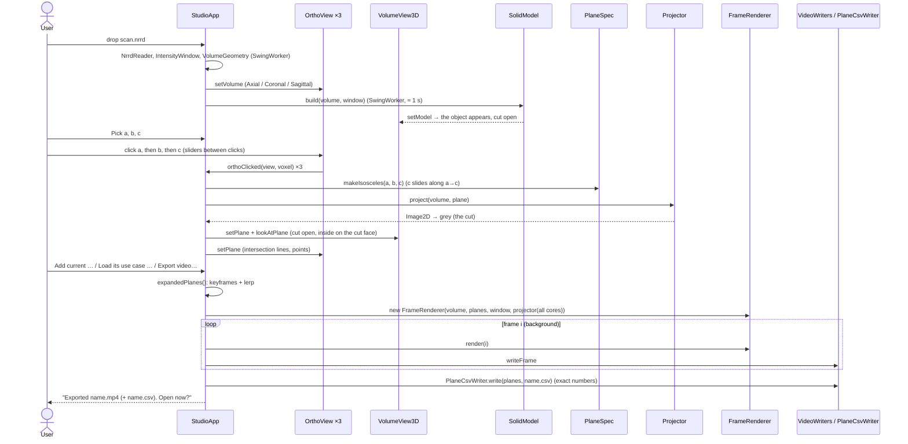

# Software Design Document (SDD)

**Project:** Ex1 — Plane Projection of a 3D Volume · **Version:** 3.1 (3.0 added the app; 3.1: the
course's point order and row classes, the cut-open solid, Slicer's three views, point picking —
§3, §4.1, §5.1, §6, §8, ADR-0003/0004 revised, ADR-0009)
**Answers:** how is the system structured, and what did we reject?
**Inputs:** [SRS](SRS.md) · **Details per component:** [ALGORITHM.md](ALGORITHM.md) (EDD of the projection) ·
**Decisions:** [ADRs](adr/)

---

## 1. Context and goals

One library computes plane projections of a 3-D volume fast enough for interactive use; two thin
front ends use it: **the app** (choose a cut by picking 3 points on Slicer's three views or on the
object, see the object cut open with its inside showing, see the cut, collect the planes of a use
case, export its video) and the command-line demo required by the assignment. Goals, in order:
correct and robust on any input, exactly as the lecturer's test files expect (SRS REQ-04…07,
NFR-04) · ≥ 30 FPS single-threaded on 500³ (NFR-01) · readable, tested, explainable code ·
reusable on Android later.

**Non-goals:** CSV points in millimetres, colour volumes, GPU, networking. **Constraint from the team:**
it must run straight after download — nothing to install (ADR-0010).

## 2. Context diagram (C4 level 1)

## 3. Containers and components (C4 levels 2–3)

Two Gradle modules, one runnable jar.

**Dependency rule:** `core` knows nothing about files, pixel formats or the UI; `app` depends on
`core`, never the other way round ([ADR-0002](adr/0002-core-app-split.md)). This is the "ports and
adapters" split from the course modules: `VideoWriter` is a port, the three writers are adapters.
`Volume` carries the NRRD's `space`/`space directions` as plain data; only the app interprets them.

### 3.1 Responsibilities

| Component | Responsibility | Key design choice |
|-----------|----------------|-------------------|
| `Volume` + subclasses | Hold `M` at native sample width; `valueAt(i)` returns a float; keep the header's space directions | One abstract class, four typed arrays: 8-bit volume = 1 byte/voxel (NFR-03) |
| `Plane` | The trapezoid `(a1, a2, b, c)`; triangle = `a1 == a2`; `validate` (doubtful problems), `whyNotRenderable` (the bad reason), image size | One shape for the whole pipeline; two levels of "wrong" ([ADR-0003](adr/0003-invalid-rows-policy.md)) |
| `PlaneResolver` | Turn the raw numbers of a row into the plane to project (REQ-05) | Course order `(a, b, c)` / `(a1, b, a2, c)`; Q&A order only when it alone is valid ([ADR-0004](adr/0004-csv-point-order.md)) |
| `Projector` | Template method: walk rows, centre each row, delegate sampling | Rows are independent → trivially parallel |
| `NearestProjector`, `TrilinearProjector` | `sampleRow(...)` | Inner loop: 3 adds + bounds check + 1 read |
| `ParallelProjector` | Decorator: splits rows across a fixed thread pool | Bit-identical output (NFR-05) |
| `IntensityWindow` | Global window → 8-bit grey (REQ-12) | Percentiles; `[min, max]` for few-valued volumes (the die) |
| `Image2D` | `float[]` result buffer, reused between frames | No per-frame allocation |
| `NrrdReader` | NRRD header + raw/gzip data → `Volume` (+ space directions) | Streams 1 MB chunks straight into the typed array |
| `PlaneCsvReader` | CSV → one entry per data row: plane or null (black) + warnings | Count must match the points; doubtful rows keep their plane, bad rows get none; never aborts on a bad row |
| `PlaneCsvWriter` | Planes → CSV in the course format and order | Exact numbers (shortest round-trip decimal) → the CSV reads back bit for bit, so video ≡ demo(CSV) |
| `VideoWriter` family | Frames → MP4 / PNG | Built-in encoder as the always-works path |
| `FrameRenderer` | Plane *i* → grey frame *i*, common frame size; null → black | Shared by CLI and GUI, so both produce identical frames |
| `Ex0` | Argument parsing, exit codes, orchestration | Pipeline reads top-down |
| `StudioApp` | The app: toolbar, the four views, points editor (3/4 points, pick, Apply, Make isosceles), plane editor (presets, sliders), use-case list, playback, export; owns the current plane and tells every view | Swing only; projection on every change (≈ 1–10 ms); model build and export on `SwingWorker`s |
| `PlaneSpec` | The *movable* form of a plane: centre, yaw/pitch/roll, width, height, top ratio; `toPlane`, `fromPlane`, `lerp`, presets, `makeIsosceles` | Every spec is a valid plane by construction; interpolation in this space ([ADR-0008](adr/0008-plane-spec-and-software-renderer.md)) |
| `VolumeGeometry` | Index ⇄ world millimetres from `space directions`; which index axis is Axial/Coronal/Sagittal, their direction on screen, labels; `slicePlane(view, k)` | The display follows the patient's axes; the CSV stays in indices ([ADR-0009](adr/0009-cut-open-solid-and-point-picking.md)) |
| `SolidModel` | The scan as a solid: windowed grey ≤ 256³, smoothed, Otsu threshold (adjustable), specks removed, outside air flood-filled through a closing, 8³ occupancy blocks | Dark insides stay part of the object, so the cut face shows them |
| `CutawayRenderer` | One ray per pixel: removes the half on the viewer's side of the plane, shows the scan's grey on the cut face, shades the surface; `pick(px, py)` returns the clicked point | Index-space rays, empty-block skipping, thread pool, writes the shared depth buffer |
| `VolumeView3D` | The 3-D view: renderer + box + plane outline + points; orbit / zoom / wheel-slide / double-click reset / click to pick | Half resolution while moving, sharp 160 ms later |
| `Raster`, `Camera3D` | Colour + depth buffers, depth-tested lines/triangles; orthographic orbit camera with `lookFrom` / ray origins | JDK only, `int[]` ARGB, Android-portable |
| `OrthoView` | One slice view (Axial, Coronal or Sagittal): slider, the plane's intersection line, the points, crosshair, labels; click to pick | Same window as the video; shared labels for points that coincide in the view |
| `SliceView` | The cut as a 2-D image with its corner names (`a` / `a1 a2`, `b`, `c`) | Fits the panel, keeps the frame's aspect |

## 4. Class diagram (C4 level 4, core)

### 4.1 Class diagram — the app

Why two forms of a plane: the sheet's 3 or 4 points are the interface to files, to the algorithm
and — now — to the user, who picks them; but they are a poor thing to *move*: shifting one point
breaks the isosceles rule. `PlaneSpec` is the movable view (where, which way, how big); the
conversion to points is one place, tested (TC-80…TC-85), its inverse loads a CSV row or picked
points into the sliders, and `makeIsosceles` turns imprecise clicks into a valid plane with one
stated change (TC-90).

Why the views talk to the app through small `Host` interfaces (`VolumeView3D.Host`,
`OrthoView.Host`): the app owns the current plane and the picking state; a view only reports
gestures ("slide by 2 voxels", "clicked this voxel") — the observer pattern from the course
decks, which keeps the views free of application logic.

## 5. Key flow: UC-01 demo (sequence)

### 5.1 Key flow: UC-02 / UC-05 — pick 3 points, look inside, export (sequence)

## 6. Data

| Data | Representation | Why |
|------|----------------|-----|
| Volume | flat typed array, `index = x + sx·(y + sy·z)` | NRRD on-disk order: no reshuffle on load; x-fastest matches the inner loop |
| Plane | four `Vec3` (doubles), voxel indices | fractional coordinates allowed by the CSV |
| Plane, while moving | `PlaneSpec` (9 doubles) | always valid; the only form the sliders and the interpolation touch |
| Picked points | `Vec3` voxel indices | the same space as the CSV; the views convert with `VolumeGeometry` |
| Solid model | `byte[]` smoothed grey + `byte[]` state per model voxel (≤ 256³ each), `boolean[]` per 8³ block | a ray needs "solid here?" and a gradient; blocks let it skip air |
| 3-D frame | `Raster`: `int[]` ARGB + `float[]` depth | the ray caster and the line drawing share one depth buffer |
| Projection | `float[]` `W×H` | holds any voxel type without loss before windowing |
| Frame | `byte[]` grey, `W×H` even | what both MP4 writers and PNG need |
| Video | H.264 in MP4 | REQ-14; the built-in writer uses I_PCM macroblocks (lossless, large), ffmpeg uses x264 (small) |

## 7. Deployment

* **Desktop (Windows): download and run** ([ADR-0010](adr/0010-ship-the-java-runtime.md)). The
  repository carries everything the app needs: `Ex1.exe` (a small Win32 launcher, `launcher/Ex1.c`),
  `runtime/` (OpenJDK 25.0.1 for Windows x64 cut to `java.base` + `java.desktop` by `jlink`, 47 MB)
  and the compiled `build/Ex0.jar`. `Ex1.exe` starts `runtime\bin\javaw.exe -jar build\Ex0.jar`;
  `Ex1 Viewer.bat`, `Ex0.bat` and `Ex0.py` also try `runtime/` first, then a JDK on the machine
  (IntelliJ `.jdks`, Android Studio `jbr`, `JAVA_HOME`, `PATH`).
* **Desktop (Linux/macOS):** the same jar on any Java 17+ (`./Ex0`, `python Ex0.py`).
* **CI:** GitHub Actions, matrix {ubuntu, windows} × {JDK 17, 21}: build with `-Werror`, 90 unit
  tests (including the lecturer's edge cases), the demo command on the course CSV and on the
  edge cases with frame-count checks, a strict-mode failure check, and a 500³ benchmark gate
  (≥ 30 FPS).
* **Android (future):** `core` compiles unchanged (no `java.io.File`, no AWT); the app would add a
  `MediaCodec` `VideoWriter`, a `ContentResolver`-based NRRD source, and reuse `PlaneSpec`,
  `SolidModel`, `CutawayRenderer`, `Raster` and `Camera3D` (all `int[]`/`byte[]` based).

## 8. Rationale and alternatives considered

| Decision | Chosen | Rejected | Why | ADR |
|----------|--------|----------|-----|-----|
| Language | Java 17 + Python launcher | Python/NumPy, C++ | 300+ FPS is realistic in Java; team plans an Android port; the launcher keeps the sheet's `python Ex0.py` form | [0001](adr/0001-java-with-python-launcher.md) |
| Module split | `core` / `app` | single module | Android reuse, testability of the algorithm without I/O | [0002](adr/0002-core-app-split.md) |
| Rows that break the rules | doubtful → drawn + warning; bad → black + warning; `--strict` to abort | abort on first error; silently skip; draw everything | item 7c (frame per row) and the lecturer's own `edge_cases.csv` expectations | [0003](adr/0003-invalid-rows-policy.md) |
| Point order | course order `a1, b, a2, c`; Q&A order only when it alone is valid | Q&A order first (our v3.0); trying every permutation | the lecturer's files are written that way and come out the right way up | [0004](adr/0004-csv-point-order.md) |
| Video | built-in I_PCM H.264 writer + optional ffmpeg | ffmpeg only; JCodec | no install step for the grader; no third-party jars (offline build) | [0005](adr/0005-built-in-mp4-writer.md) |
| Grey mapping | one percentile window per video | per-frame min/max | no flicker; outliers ignored | [0006](adr/0006-global-intensity-window.md) |
| Parallelism | row blocks on a fixed pool, default 1 thread | always all cores; per-pixel tasks | requirement is single-threaded; rows independent → identical output | [0007](adr/0007-row-parallelism.md) |
| Moving a plane; drawing in 3-D; CSV numbers | `PlaneSpec`; software buffers; exact numbers | moving raw points; JavaFX 3D / JOGL; fixed decimals | points break the isosceles rule when moved; no native jars; bit-exact round trips | [0008](adr/0008-plane-spec-and-software-renderer.md) |
| Getting it to run | the Java runtime (`jlink`, 47 MB), the jar and a native `Ex1.exe` in the repository | "install Java 17+"; a jpackage installer; a full JRE; a release asset only | the requirement: download and run, nothing to install | [0010](adr/0010-ship-the-java-runtime.md) |
| What the 3-D view shows; how a plane is chosen | the scan as a solid, cut open by the plane, ray cast on the CPU; picking 3 points on Axial/Coronal/Sagittal or on the object | mid-slices in a box (our v3.0); marching cubes; translucent volume rendering; typing coordinates only | what the lecturer asked for: choose 3 points and see how the object looks inside that cut, like a pie cut in the middle | [0009](adr/0009-cut-open-solid-and-point-picking.md) |

## 9. Risks and trade-offs

| Risk | Impact | Mitigation |
|------|--------|------------|
| Grader's machine has no Java | demo does not run | Windows: Java ships with the app (`runtime/`, ADR-0010); other OSes: the launcher prints a clear message with the download link; CI proves it on clean Windows/Linux images |
| `Ex1.exe` is not code-signed | SmartScreen may ask once on a downloaded copy | README says what to click; `Ex1 Viewer.bat` and `python Ex0.py` are alternatives |
| Built-in MP4 files are large (~1.5 B/pixel/frame) | a 500-frame 500² video ≈ 190 MB | ffmpeg path used automatically when present; `--fps`/frame count under user control; documented |
| The surface threshold does not suit a scan | holes in the skin or a "fog" of noise in the 3-D view | Otsu default (works on all five lecturer scans), Surface slider, speck removal; the cut itself never depends on it |
| A large scan (500³) | slower model (2.6 s) and renders | model at ≤ 256³, built in the background, block skipping, half resolution while moving |
| Anisotropic voxels (MRHead 1.3 mm on one axis) | video frames slightly stretched | the projection follows the assignment (voxel units, EDD D10); the app's views use millimetres |
| Course algorithm ambiguities | grader expects a different pixel-level convention | every choice documented (EDD §5); the lecturer's own files used as acceptance tests |
| Memory for 1000³ volumes | 1 GB heap | `-Xmx2g` in launchers; chunked loader; clear OOM message |
| Swing look differs per OS | screenshots differ from the user's screen | layout uses only standard components and sizes; checked on Windows 11 and Linux |

## 10. Open questions
* Should the apex row (`y = 0`) be sampled? The sheet's loop starts after one step; we include it
  (EDD D1). Either reading differs by one row.
* *Resolved in 3.1:* the orientation of 4-point rectangles — the lecturer's files list the points
  rail by rail (`a1, b, a2, c`), which fixes it ([ADR-0004](adr/0004-csv-point-order.md)).
