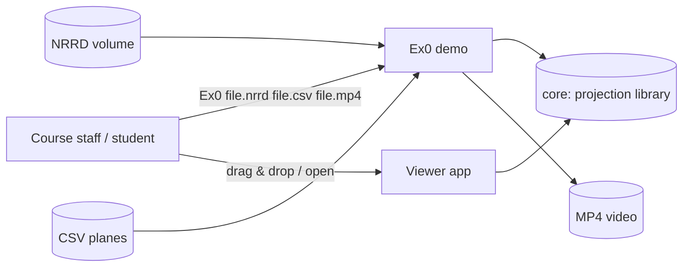

# Software Requirements Specification (SRS)

**Project:** Ex1 — Plane Projection of a 3D Volume
**Course:** Introduction to Software Engineering (OOP/OOD), Ariel University, Prof. Boaz Ben-Moshe
**Version:** 2.0 (baselined for submission) · **Status:** all requirements implemented and verified
**Related documents:** [SDD](SDD.md) (architecture) · [ALGORITHM / EDD](ALGORITHM.md) (detailed design of the
projection) · [STP/STD](TESTING.md) (tests) · [ADRs](adr/) · [Experiment](EXPERIMENT.md)

---

## 1. Introduction

### 1.1 Purpose
This document specifies the requirements of a program that computes 2-D cross-section images
("projections") of a 3-D volumetric image (MRI/CT in NRRD format) along arbitrary planes, and
writes a sequence of such images as an MP4 video. It is the contract between the assignment
sheet (`Ex1` PDF + Q&A) and the implementation, and every requirement below is traced to a design
element and to a test (§5).

### 1.2 Scope
*In scope:* reading NRRD volumes; reading plane definitions from CSV; validating planes per the
Q&A; computing projections with nearest-neighbour or trilinear sampling; mapping intensities to
8-bit grey; writing MP4 (and optional PNG frames); a benchmark; synthetic test volumes; a small
desktop viewer.

*Out of scope (non-goals):* physical/RAS (millimetre) coordinates; colour, vector or 4-D volumes;
detached multi-file NRRD (`data file: LIST`); GPU acceleration; an Android front end (planned
reuse of `core`, see SDD §7).

### 1.3 Definitions
| Term | Meaning |
|------|---------|
| Volume `M` | 3-D array `M[x][y][z]`, sizes `1 ≤ sx, sy, sz < 2^10`, entries unsigned 8/16/32-bit (signed and float accepted too) |
| Plane `p` | Isosceles triangle `(a, b, c)` or isosceles trapezoid `(a1, a2, b, c)`; see §3.2.2 |
| Rail | One of the two equal sides walked by the algorithm: `a1→b` and `a2→c` (`a1 = a2 = a` for a triangle) |
| Frame | One projected image; frame *i* belongs to CSV data row *i* |
| EPS | Geometric tolerance, `0.001` (Q&A) |
| FPS | Projections computed per second, excluding file I/O and video encoding |
| NN / TL | Nearest-neighbour / trilinear sampling |

### 1.4 References
1. Assignment sheet *Ex1: Algorithm: Implementing a plane projection of 3D volume*, incl. Q&A.
2. Course example input `Ex0.csv` (linked from the sheet; copy in `data/Ex0.csv`).
3. NRRD format specification, http://teem.sourceforge.net/nrrd/format.html
4. 3D Slicer sample data `MRHead.nrrd`, https://github.com/Slicer/SlicerTestingData
5. ISO/IEC 14496-10 (H.264) and ISO/IEC 14496-12/14 (MP4 container), used by the built-in writer.

---

## 2. Overall description

### 2.1 Product perspective
A stand-alone command-line tool (the assignment's "demo main") plus an optional window app,
both built on one reusable projection library (`core`). There is no server and no database.



### 2.2 User classes
| User | Needs |
|------|-------|
| Course staff (grader) | Run the exact command of the sheet on their own files and get a correct video, with clear messages on bad input |
| Team members | Readable, tested code they can explain and extend (Android follow-up) |
| Future Android app | A projection API with no desktop dependencies |

### 2.3 Operating environment
Any OS with a Java 17+ runtime. Python 3 is used only by the `Ex0.py` launcher (standard library).
No other software is required: the MP4 encoder is built in (ffmpeg is used automatically when
installed, for smaller files). Reference performance platform: a 2020+ laptop CPU, one thread.

### 2.4 Constraints
* C-1 Language from the allowed list: **Java** ([ADR-0001](adr/0001-java-with-python-launcher.md)).
* C-2 `core` uses only `java.lang`, `java.util`, `java.util.concurrent` ([ADR-0002](adr/0002-core-app-split.md)).
* C-3 No third-party runtime libraries; build works offline (JUnit jars are vendored in `lib/`).
* C-4 Volume stored once, at native sample width (a 1000³ 8-bit volume = 1 GB).

### 2.5 Assumptions
* A-1 CSV coordinates are voxel indices in `[0, s)` per axis (the course file uses 0…500).
* A-2 The grader may use planes that break the Q&A rules on purpose (the course file does);
  robustness is judged by behaviour on such input.
* A-3 Videos are watched in standard players (Windows Media Player, browsers, phones).

---

## 3. Specific requirements

### 3.1 Functional requirements

| ID | Requirement | Priority |
|----|-------------|----------|
| **REQ-01** | The program shall run as `python Ex0.py <file.nrrd> <file.csv> <file.mp4> [options]` and, equivalently, `Ex0 …` / `java -jar build/Ex0.jar …`. | Must |
| **REQ-02** | It shall read NRRD files with `dimension: 3`, encodings `raw` and `gzip`, little/big endian, types int8/uint8/int16/uint16/int32/uint32/float, attached or single detached data file, any `byte skip ≥ 0`. | Must |
| **REQ-03** | An unsupported or malformed NRRD shall be rejected with a message naming the offending field; exit code 2. | Must |
| **REQ-04** | The CSV shall be read in the course format: one plane per row, first cell = number of points (3 or 4), then `x1,y1,z1,…`; cells may be quoted and empty; a header row, blank/`,,,` rows and `#` comments are skipped. Rows of plain 9 or 12 numbers shall also be accepted; a count that disagrees with the points given (e.g. `3` followed by 12 numbers because unused cells hold zeros) shall be repaired and noted. | Must |
| **REQ-05** | Three points shall be read as `(a, b, c)`; four points as `(a1, a2, b, c)`. If that reading breaks the rules of REQ-06 but another reading of the same points satisfies them (two rails `p1→p2, p3→p4`; another apex), that reading shall be used and reported. | Should |
| **REQ-06** | Each plane shall be validated with `EPS = 0.001`: triangle `|ab| − |ac| < EPS`; trapezoid `|a1b| − |a2c| < EPS`, `|a1a2| ≤ |bc|`, `a1→b` and `a2→c` coplanar; in addition a rail length ≥ 1 and no collinear triangle. | Must |
| **REQ-07** | Every CSV data row shall produce exactly one video frame, in file order. A row that violates REQ-06 in every reading shall be projected anyway (the algorithm is well defined) and reported as a warning with its row and line number; a row that cannot be projected at all (non-numbers, wrong count, NaN, zero-length rail) shall produce a black frame and a warning. | Must |
| **REQ-08** | With `--strict`, any warning of REQ-07 shall stop the program with exit code 2 and no video written. | Should |
| **REQ-09** | A valid plane shall be projected by the algorithm of the assignment as detailed in [ALGORITHM.md §3](ALGORITHM.md): rows `y = 0…⌊Dab⌋`, one unit per step along both rails and along each row, every row centred in the image. | Must |
| **REQ-10** | Sample points outside `M` and pixels outside the plane shape shall have value 0. | Must |
| **REQ-11** | Sampling shall be nearest-neighbour by default (`M[round(p)]`) and trilinear with `--interp trilinear`. | Must / Should |
| **REQ-12** | Intensities shall be mapped to 0–255 with one global linear window for the whole run (default: 0.5 % – 99.5 % percentiles of the volume; `--window LO HI` overrides). | Must |
| **REQ-13** | All frames of a video shall have one size (largest plane, rounded up to even); each frame is centred on black. | Must |
| **REQ-14** | The MP4 shall be playable without extra software on the viewer's side (H.264 in an ISO-BMFF container) and shall be written without any external program; ffmpeg shall be used automatically when present. | Must |
| **REQ-15** | Options: `--interp nearest|trilinear`, `--fps N` (1–120, default 10), `--window LO HI`, `--frames DIR` (PNG per frame), `--threads N|auto`, `--strict`. Unknown options → usage message, exit 1. | Should |
| **REQ-16** | A benchmark command shall report FPS for NN and TL sampling on a synthetic `N³` 8-bit volume (default 500³), single-threaded and with all cores. | Must |
| **REQ-17** | Generators shall produce demo plane lists (sweep / rotate / tilt / triangle) and synthetic phantom volumes (uint8/16/32) whose cross-sections are known. | Should |
| **REQ-18** | A window app shall open or accept a dropped `.nrrd`, play the projections live, allow loading a CSV, and export MP4 — using the same `core` code as the demo. | Could |

### 3.2 External interface requirements

#### 3.2.1 Command line
```
python Ex0.py file.nrrd file.csv file.mp4 [--interp nearest|trilinear] [--fps N]
              [--window LO HI] [--frames DIR] [--threads N|auto] [--strict]
```
Exit codes: `0` success · `1` usage error · `2` invalid input (NRRD/CSV/`--strict`) · `3` output error
· `4` (launcher only) no Java ≥ 17 found. Warnings go to `stderr`, progress to `stdout`.

#### 3.2.2 CSV input (the course's `Ex0.csv`)
```
"Number of Points (3 or 4)","x1","y1","z1","x2","y2","z2","x3","y3","z3","x4","y4","z4"
"3","200","200","0","0","200","400","400","200","400","","",""
"4","200","0","0","200","0","500","200","400","0","200","400","500"
"3","200","200","-30","-50","200","400","400","250","400","","",""
"4","200","50","0","200","0","500","200","350","0","200","400","500"
```
Row 3 is not isosceles (`|ab| = 497.39`, `|ac| = 476.86`): warned, still projected (REQ-07).
Row 4 is not isosceles as `(a1, a2, b, c)` (300 vs 400) but is a valid isosceles trapezoid read as
two rails `p1→p2`, `p3→p4` (502.5 each, bases 300 ≤ 400): used with a note (REQ-05).

#### 3.2.3 NRRD input
Per reference 3. Supported fields: `type`, `dimension`, `sizes`, `encoding`, `endian`,
`byte skip`, `data file`. Geometry fields (`space directions`, `space origin`) are read past and
ignored (A-1, non-goal).

#### 3.2.4 MP4 output
One video stream, H.264 Constrained Baseline, `yuv420p` (ffmpeg path) or monochrome I_PCM
frames (built-in path), frame rate `--fps`, frame count = CSV data rows.

### 3.3 Non-functional requirements

| ID | Requirement | Verification |
|----|-------------|--------------|
| **NFR-01 Performance** | NN projection on a 500³ 8-bit volume, planes up to ~700×700 px, **one thread**: ≥ 30 FPS (must), ≥ 100 FPS (target). | Benchmark, CI gate (≥ 30) |
| **NFR-02 Scalability** | With `--threads auto` the frame time shall not be worse than single-threaded for planes ≥ 16 rows, and the output shall be bit-identical. | `ParallelProjectorTest`, benchmark |
| **NFR-03 Memory** | Peak memory ≤ volume size + 2 MB during load, + one image buffer during projection. | Code review (`NrrdReader` chunked load), 1000³ benchmark with `-Xmx2g` |
| **NFR-04 Robustness** | No uncaught exception on any input file; every failure has a message and an exit code. | `Ex0Test`, `NrrdReaderTest`, CI "invalid input" step |
| **NFR-05 Determinism** | Same inputs → byte-identical frames, regardless of thread count. | `ParallelProjectorTest`, CI frame diff |
| **NFR-06 Portability** | Builds and tests pass on Linux and Windows with JDK 17 and 21, offline. | CI matrix |
| **NFR-07 Maintainability** | Javadoc on every method; `-Xlint:all -Werror`; `core` free of desktop APIs. | Build, review |
| **NFR-08 Usability** | A user without a terminal can run the viewer by double-click and get a video in ≤ 3 actions. | Manual test (Windows) |

---

## 4. Use cases

### UC-01 Render the demo video (grader)
* **Actor:** course staff · **Precondition:** Java 17+ installed; an NRRD and a CSV file.
* **Main flow:** 1. Staff runs `python Ex0.py vol.nrrd planes.csv out.mp4`. 2. System loads the
  volume and prints its size/type. 3. System reads the CSV, resolves each row (REQ-05), prints
  warnings. 4. System computes the global window. 5. System projects every row and writes
  `out.mp4`. 6. System prints frames, FPS and the output path; exit 0.
* **Alternatives:** 2a. File missing/unsupported → message, exit 2. 3a. No usable row → exit 2.
  3b. `--strict` and warnings → exit 2, no file. 5a. Output not writable → exit 3.
* **Postcondition:** `out.mp4` has exactly one frame per CSV data row, in order.

### UC-02 Explore a volume interactively (student / demo day)
* **Actor:** student · **Precondition:** `Ex1 Viewer.bat` (or `Ex0.py` without arguments).
* **Main flow:** 1. Student double-clicks the launcher. 2. Drops `MRHead.nrrd` on the window (or
  Open NRRD / Open sample). 3. System loads it, builds "Rotate" planes and starts playing.
  4. Student switches planes (Sweep/Tilt/Triangle/CSV), sampling and frame count; scrubs with
  the slider. 5. Student clicks Export MP4 and chooses a file. 6. System writes it and offers to
  open it.
* **Alternatives:** 2a. Dropped file is a CSV before a volume → message. 4a. CSV with warnings →
  dialog listing them, rows still shown. 5a. Export fails → error dialog.

### UC-03 Prove the performance requirement
* **Actor:** team member / grader. **Flow:** `java -cp build/Ex0.jar ex1.app.Benchmark 500` →
  table of FPS for NN/TL × threads with PASS/FAIL against 30 and 100 FPS.
* **Postcondition:** numbers recorded in [EXPERIMENT.md](EXPERIMENT.md); CI repeats the ≥ 30 check.

### UC-04 Build a test dataset
* **Actor:** team member. **Flow:** `PhantomGenerator spheres uint8 500 data/x.nrrd` and
  `SweepGenerator rotate 256 256 130 90 data/x.csv` → files that any run of UC-01 can use;
  cross-sections of phantoms are known in advance (rings, checkerboard, ramp).

---

## 5. Traceability matrix

| Requirement | Use case | Design (SDD / EDD) | Tests (STD) | Status |
|-------------|----------|--------------------|-------------|--------|
| REQ-01 | UC-01 | SDD §4 `Ex0`, `Ex0.py`, `Ex0.bat` | TC-30, TC-31, CI demo step | Pass |
| REQ-02 | UC-01 | SDD §4 `NrrdReader`, `Volume` family | TC-20 (28 round trips), TC-21, TC-22 | Pass |
| REQ-03 | UC-01 | `NrrdReader` error paths | TC-23–TC-28 | Pass |
| REQ-04 | UC-01 | `PlaneCsvReader` | TC-40, TC-41, TC-42, TC-43 | Pass |
| REQ-05 | UC-01 | `PlaneResolver` ([ADR-0004](adr/0004-csv-point-order.md)) | TC-10–TC-14, TC-44 | Pass |
| REQ-06 | UC-01 | `Plane.validate` (EDD §6) | TC-01–TC-09 | Pass |
| REQ-07 | UC-01 | `PlaneCsvReader`, `FrameRenderer` ([ADR-0003](adr/0003-invalid-rows-policy.md)) | TC-44, TC-45, TC-46, TC-32 | Pass |
| REQ-08 | UC-01 | `Ex0.loadPlanes` | TC-33, CI "invalid input" step | Pass |
| REQ-09 | UC-01, UC-02 | `Projector` (EDD §3) | TC-50, TC-53, TC-54 | Pass |
| REQ-10 | UC-01 | `NearestProjector`, `TrilinearProjector` | TC-51, TC-52 | Pass |
| REQ-11 | UC-01 | `Projector.create` | TC-50–TC-55 | Pass |
| REQ-12 | UC-01 | `IntensityWindow` ([ADR-0006](adr/0006-global-intensity-window.md)) | TC-60–TC-63 | Pass |
| REQ-13 | UC-01 | `FrameRenderer` | TC-30 (ffprobe size), TC-63 | Pass |
| REQ-14 | UC-01 | `Mp4Writer`, `FfmpegVideoWriter`, `VideoWriters` ([ADR-0005](adr/0005-built-in-mp4-writer.md)) | TC-70–TC-72, TC-34 | Pass |
| REQ-15 | UC-01 | `Ex0.parseArgs` | TC-35, TC-36 | Pass |
| REQ-16 | UC-03 | `Benchmark` | CI benchmark job | Pass |
| REQ-17 | UC-04 | `SweepGenerator`, `PhantomGenerator` | TC-30 (uses both), visual (EXPERIMENT §5) | Pass |
| REQ-18 | UC-02 | `ViewerApp` | Manual test (Windows 11, JDK 25) | Pass |
| NFR-01 | UC-03 | EDD §4 cost model | Benchmark: 280–390 FPS NN single-thread | Pass |
| NFR-02 | UC-03 | `ParallelProjector` | TC-56–TC-58, benchmark | Pass |
| NFR-03 | — | `NrrdReader.readSamples` (1 MB chunks) | 1000³ run with `-Xmx2g` | Pass |
| NFR-04 | UC-01 | exit-code design (§3.2.1) | TC-23–TC-28, TC-33, TC-35, TC-47 | Pass |
| NFR-05 | — | row independence (EDD §3) | TC-56, CI | Pass |
| NFR-06 | — | scripts + vendored JUnit | CI matrix (2 OS × 2 JDK) | Pass |
| NFR-07 | — | `-Werror` in `scripts/build.*` | Build | Pass |
| NFR-08 | UC-02 | `ViewerApp`, `Ex1 Viewer.bat` | Manual | Pass |

TC numbers are defined in [TESTING.md §5 (STD)](TESTING.md).
