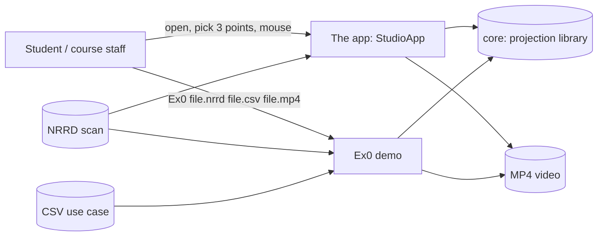

# Software Requirements Specification (SRS)

**Project:** Ex1 — Plane Projection of a 3D Volume
**Course:** Introduction to Software Engineering (OOP/OOD), Ariel University, Prof. Boaz Ben-Moshe
**Version:** 3.3 · 3.0 added the interactive app (REQ-18…REQ-24, UC-02, UC-05); **3.1** aligns the
CSV rules with the lecturer's test data (REQ-04…REQ-07), shows the scan as a solid cut open by the
plane (REQ-19), and adds Slicer's three views, choosing the plane by 3 points and the lecturer's
use cases (REQ-25…REQ-27); 3.1.1 (4 Nov) adds NFR-11: download and run, nothing to install; **3.2** (5 Nov) makes the
video what Play shows — the list or a sweep of the current plane, played back and forth, exported in one click at 10 fps —
and the app nearest-neighbour only, with the projection speed shown (REQ-11, REQ-20…REQ-24, [ADR-0011](adr/0011-the-video-is-what-play-shows.md)); **3.3** (5 Nov) makes the app "choose 3 points (or 4)": no CSV, no sliders, one picture panel, an export that never fails because of ffmpeg (REQ-14, REQ-18…REQ-27, [ADR-0012](adr/0012-points-only-app-one-picture-panel.md)); 3.3.1: always cut open, open with the system file dialog or by dragging, no sample menu (REQ-18, REQ-19, [ADR-0013](adr/0013-always-cut-open-open-from-anywhere.md)) · **Status:** all requirements implemented and verified
**Related documents:** [SDD](SDD.md) (architecture) · [ALGORITHM / EDD](ALGORITHM.md) (detailed design of the
projection) · [STP/STD](TESTING.md) (tests) · [ADRs](adr/) · [Experiment](EXPERIMENT.md)

---

## 1. Introduction

### 1.1 Purpose
This document specifies the requirements of an application that loads a 3-D scan (MRI/CT in
NRRD format), shows it as a solid object next to the three standard slice views of 3D Slicer,
lets the user **choose a cutting plane by picking 3 (or 4) points**, shows **how the object looks
inside that cut** — like a pie cut through the middle — and the resulting 2-D cross-section
("projection"), and turns a list of such planes — a *use case* — into an MP4 video and the CSV of
its planes. The same projection runs as the command-line demo of the assignment sheet. This
document is the contract between the sheet (`Ex1` PDF + Q&A, the lecturer's Python prototype and
example files, his test data) and the implementation; every requirement below is traced to a
design element and to a test (§5).

### 1.2 Scope
*In scope:* a desktop app (open / drag-and-drop a scan; a 3-D view of the scan as a solid cut open
by the plane; the live cut and the Axial/Coronal/Sagittal slice views in one picture panel;
choosing the plane by its 3 or 4 points, picked on those views or typed; playing the plane
through the scan and exporting that as MP4); reading NRRD volumes; reading plane definitions from
CSV in the course's format (the command-line demo);
validating planes per the Q&A and the lecturer's edge cases; computing projections with
nearest-neighbour or trilinear sampling; mapping intensities to 8-bit grey; writing MP4 (and
optional PNG frames); the command-line demo; a benchmark; synthetic test volumes.

*Out of scope (non-goals):* CSV points in physical/RAS (millimetre) coordinates — points are voxel
indices, as in every course file (the app's *display* does use millimetres); colour, vector or
4-D volumes; detached multi-file NRRD (`data file: LIST`); GPU acceleration; an Android front end
(planned reuse of `core`, see SDD §7).

### 1.3 Definitions
| Term | Meaning |
|------|---------|
| Volume `M` | 3-D array `M[x][y][z]`, sizes `1 ≤ sx, sy, sz < 2^10`, entries unsigned 8/16/32-bit (signed and float accepted too) |
| Plane `p` | Isosceles triangle `(a, b, c)` or isosceles trapezoid `(a1, a2, b, c)`; see §3.2.2 |
| Rail | One of the two equal sides walked by the algorithm: `a1→b` and `a2→c` (`a1 = a2 = a` for a triangle) |
| Course order | How a CSV row lists the points: `a, b, c` (triangle) and `a1, b, a2, c` — rail by rail — (trapezoid) |
| Doubtful / bad plane | A plane that breaks a rule but can still be drawn / that cannot be drawn sensibly (§3.2.2, ADR-0003) |
| Frame | One projected image; frame *i* belongs to CSV data row *i* |
| Cut open | The 3-D view with the half of the object between the viewer and the plane removed, so the cut face shows the inside |
| Axial / Coronal / Sagittal | Slices across the patient's S–I, A–P and R–L axes (from the NRRD `space directions`), as in 3D Slicer |
| EPS | Geometric tolerance, `0.001` (Q&A) |
| FPS | Projections computed per second, excluding file I/O and video encoding |
| NN / TL | Nearest-neighbour / trilinear sampling |

### 1.4 References
1. Assignment sheet *Ex1: Algorithm: Implementing a plane projection of 3D volume*, incl. Q&A.
2. Course example input `Ex0.csv` (linked from the sheet; copy in `data/Ex0.csv`).
3. The lecturer's test data (Google Drive folder linked by the course): `MRHead_1.nrrd`,
   `onion.nrrd`, `croissant.nrrd`, `swiss_roll.nrrd`, `biscuit_cake.nrrd`, their use-case CSVs,
   `edge_cases.csv` and example images. The CSVs are copied in `data/course/`; the scans are not
   stored (size), see `data/README.md`.
4. NRRD format specification, http://teem.sourceforge.net/nrrd/format.html
5. 3D Slicer sample data `MRHead.nrrd`, https://github.com/Slicer/SlicerTestingData
6. ISO/IEC 14496-10 (H.264) and ISO/IEC 14496-12/14 (MP4 container), used by the built-in writer.

---

## 2. Overall description

### 2.1 Product perspective
A stand-alone desktop app (the product) and the assignment's command-line "demo main", both
built on one reusable projection library (`core`). One executable (`build/Ex0.jar`) contains
both: no arguments opens the app, three arguments runs the demo. There is no server and no
database.



### 2.2 User classes
| User | Needs |
|------|-------|
| Course staff (grader) | Open the app, load one of their test scans, choose a cut, see the object cut open and the cut itself, load their use-case CSV and get the video — or run the exact command of the sheet on their own files; clear messages on bad input either way |
| Team members | Readable, tested code they can explain and extend (Android follow-up) |
| Future Android app | A projection API with no desktop dependencies |

### 2.3 Operating environment
**Windows x64: nothing** — the app ships its own Java runtime (`runtime/`) and launcher (`Ex1.exe`).
Other OSes: any Java 17+ runtime and a desktop (the app is Swing; the demo also runs headless).
Python 3 is used only by the `Ex0.py` launcher (standard library).
No other software is required: the MP4 encoder is built in (ffmpeg is used automatically when
installed, for smaller files). Reference performance platform: a 2020+ laptop CPU, one thread.

### 2.4 Constraints
* C-1 Language from the allowed list: **Java** ([ADR-0001](adr/0001-java-with-python-launcher.md)).
* C-2 `core` uses only `java.lang`, `java.util`, `java.util.concurrent` ([ADR-0002](adr/0002-core-app-split.md)).
* C-3 No third-party runtime libraries; build works offline (JUnit jars are vendored in `lib/`). The
  bundled `runtime/` is the JDK's own runtime, cut down by `jlink` ([ADR-0010](adr/0010-ship-the-java-runtime.md)).
* C-4 Volume stored once, at native sample width (a 1000³ 8-bit volume = 1 GB).

### 2.5 Assumptions
* A-1 CSV coordinates are voxel indices in `[0, s)` per axis (the course file uses 0…500, the
  lecturer's use cases 0…255 on 256×256×130 scans).
* A-2 The grader uses planes that break the rules on purpose (`Ex0.csv` row 3, the 10 doubtful
  and bad rows of `edge_cases.csv`); robustness is judged by behaviour on such input.
* A-3 Videos are watched in standard players (Windows Media Player, browsers, phones).

---

## 3. Specific requirements

### 3.1 Functional requirements

| ID | Requirement | Priority |
|----|-------------|----------|
| **REQ-01** | The program shall run as `python Ex0.py <file.nrrd> <file.csv> <file.mp4> [options]` and, equivalently, `Ex0 …` / `java -jar build/Ex0.jar …`. | Must |
| **REQ-02** | It shall read NRRD files with `dimension: 3`, encodings `raw` and `gzip`, little/big endian, types int8/uint8/int16/uint16/int32/uint32/float, attached or single detached data file, any `byte skip ≥ 0`; `space` and `space directions` shall be read for the app's display. | Must |
| **REQ-03** | An unsupported or malformed NRRD shall be rejected with a message naming the offending field; exit code 2. | Must |
| **REQ-04** | The CSV shall be read in the course format: one plane per row, first cell = number of points (3 or 4), then `x1,y1,z1,…`; cells may be quoted, empty, or padded with spaces; numbers may use exponents (`1.59e2`); a header row, blank/`,,,` rows and `#` comments are skipped. Rows of plain 9 or 12 numbers shall also be accepted. A count that disagrees with the points given (e.g. `4` followed by 9 numbers) makes the row **bad** (REQ-07). | Must |
| **REQ-05** | The points shall be read in the **course order**: 3 points as `(a, b, c)`, 4 points as `(a1, b, a2, c)` — rail by rail. Only if that reading breaks REQ-06 and the Q&A order `(a1, a2, b, c)` satisfies all of it shall the Q&A order be used, with a note. No other reordering. | Must |
| **REQ-06** | Each plane shall be validated with `EPS = 0.001` (EDD §6). *Doubtful* if it breaks: equal legs (`|ab| − |ac| < EPS`, `|a1b| − |a2c| < EPS`), top parallel to the base, top no wider than the base, legs ≥ 1. *Bad* if: a coordinate is not finite, a side has length 0 or `b = c`, the triangle is collinear, the four points are not coplanar, the sides cross, or the image would exceed 8192 px. | Must |
| **REQ-07** | Every CSV data row shall produce exactly one video frame, in file order: a valid row its projection; a **doubtful** row its projection drawn as given (the algorithm's rails `a1→b`, `a2→c`) **and** a warning; a **bad** row (REQ-04 count mismatch, non-numbers, or REQ-06 bad) a **black frame and** a warning; a valid plane that misses the volume a black frame **without** a warning. Warnings name the row and line number. A file without any usable row is an error (exit 2). | Must |
| **REQ-08** | With `--strict`, any warning of REQ-07 shall stop the program with exit code 2 and no video written. | Should |
| **REQ-09** | A valid plane shall be projected by the algorithm of the assignment as detailed in [ALGORITHM.md §3](ALGORITHM.md): rows `y = 0…⌊Dab⌋`, one unit per step along both rails and along each row, every row centred in the image. | Must |
| **REQ-10** | Sample points outside `M` and pixels outside the plane shape shall have value 0. | Must |
| **REQ-11** | Sampling shall be nearest-neighbour (`M[round(p)]`, the sheet's `M[p]`) — the only sampling of the app; the command line also offers trilinear with `--interp trilinear`. | Must / Could |
| **REQ-12** | Intensities shall be mapped to 0–255 with one global linear window for the whole run (default: 0.5 % – 99.5 % percentiles of the volume, or `[min, max]` when the volume has ≤ 16 distinct grey levels; `--window LO HI` overrides). | Must |
| **REQ-13** | All frames of a video shall have one size (largest plane, rounded up to even); each frame is centred on black. | Must |
| **REQ-14** | The MP4 shall be playable without extra software on the viewer's side (H.264 in an ISO-BMFF container) and shall be written without any external program; ffmpeg shall be used automatically when present **and able to encode H.264** (asked once with `-encoders`); if it fails while writing, the same frames shall be written with the built-in encoder, with a warning. | Must |
| **REQ-15** | Options: `--interp nearest|trilinear`, `--fps N` (1–120, default 10), `--window LO HI`, `--frames DIR` (PNG per frame), `--threads N|auto`, `--strict`. Unknown options → usage message, exit 1. | Should |
| **REQ-16** | A benchmark command shall report FPS for NN and TL sampling on a synthetic `N³` 8-bit volume (default 500³), single-threaded and with all cores. | Must |
| **REQ-17** | Generators shall produce demo plane lists (sweep / rotate / tilt / triangle) and synthetic volumes (spheres, checkerboard, gradient, the die of the lecturer's edge cases) whose cross-sections are known. | Should |
| **REQ-18** | The app shall open a scan with the **system's own file dialog** (on Windows the Explorer one, so from anywhere on the computer), from a `.nrrd`/`.nhdr` file dropped anywhere on the window or on the launcher icon; it shall show the scan's name, size, type and voxel spacing, and report unreadable files in a dialog. A dropped `.csv` gets a hint with the command-line form (REQ-22). No sample menu (ADR-0013). | Must |
| **REQ-19** | The app shall show the scan **as a solid object, cut open by the current plane**: the half of the object between the viewer and the plane is removed, and the cut face shows the scan's own grey values — the inside of the object (full brightness inside the triangle/trapezoid, darker outside it) — next to the shaded outer surface, with the volume's box, the outline of the plane and its points. The surface threshold shall be found automatically and the object shall always be shown cut open (no controls for either, ADR-0013). The view shall orbit with the mouse, zoom with Ctrl+wheel, move the plane with the wheel, and reset on double-click. | Must |
| **REQ-20** | The app shall show the cut of the current plane as a 2-D image identical to the video frame (REQ-09…REQ-13), with its size, and shall update all views after every change (the 2-D cut within one frame time, NFR-01; the 3-D view interactively, NFR-10). The toolbar shall show the projection speed in frames per second: the median of the last 15 projections of the current plane (nearest neighbour, one thread, drawing not counted). | Must |
| **REQ-21** | The plane shall be chosen **by its points only** — 3 (triangle) or 4 (trapezoid), clicked (REQ-26) or typed (Enter applies) — with a *Make isosceles* action offered while the plane is doubtful; switching between 3 and 4 points shall keep the plane's place and size; the mouse wheel on the 3-D view moves the plane along its normal. No sliders or preset buttons (ADR-0012). Next to the points only problems shall be shown: *doubtful* with the rule it breaks, *bad* (a black frame) with the reason. | Must |
| **REQ-22** | The app shall not read or write CSV files: lists of planes (the lecturer's use cases and edge cases) are rendered by the command line (REQ-01, REQ-07). *(3.0–3.2: a use-case list in the app; removed in 3.3, ADR-0012.)* | Must |
| **REQ-23** | The app's **video** shall be the current plane **swept through the scan**: copies of it moved along its normal in whole-voxel steps (about 150 frames whatever the scan's size) from where its plane first meets the volume's box to where it last does, the current plane among them. **Play** shall show the video in all views at the video's rate, **back and forth** until Stop, from the current plane; Stop keeps the frame on screen. | Must |
| **REQ-24** | **Export video** shall save one pass of that video (first frame to last) as an MP4 (REQ-14) at 10 fps, the Ex0 default, with nothing to collect by hand first. The proposed file name shall not exist yet (`<scan>_cut.mp4`, `_cut_2` …); an existing file chosen anyway shall be checked before it is replaced; a failure shall say in plain words what to do (folder refused, file in use, disk full) with the technical detail, and leave no half-written file. | Must |
| **REQ-25** | The app shall show the three standard slice views of 3D Slicer — **Axial** (from above), **Coronal** (from the front), **Sagittal** (from the side) — oriented by the NRRD's patient axes with A/P, R/L, S/I labels (index axes when the file has no such header), each with a slider for its slice, the line where the cutting plane crosses the slice, the plane's points and the other two slices' crosshair. They shall share **one picture panel** with the cut (REQ-20): one picture at a time, arrows to the next / previous, wrapping from the last back to the cut. | Must |
| **REQ-26** | The user shall be able to **choose the plane by picking its 3 (or 4) points with the mouse** on any slice view or on the 3-D object (surface or cut face). Picked points that are not exactly isosceles shall be made valid by moving only `c` along `a→c` (triangle) or by the nearest isosceles trapezoid, and the app shall say what it changed. Each point can be re-picked alone. | Must |
| **REQ-27** | *(Removed in 3.3 with REQ-22: the app no longer looks for the lecturer's CSV of a scan.)* | — |

### 3.2 External interface requirements

#### 3.2.1 Command line
```
python Ex0.py file.nrrd file.csv file.mp4 [--interp nearest|trilinear] [--fps N]
              [--window LO HI] [--frames DIR] [--threads N|auto] [--strict]
```
Exit codes: `0` success · `1` usage error · `2` invalid input (NRRD/CSV/`--strict`) · `3` output error
· `4` (launcher only) no Java ≥ 17 found. Warnings go to `stderr`, progress to `stdout`.

#### 3.2.2 CSV input (the course format)
```
"Number of Points (3 or 4)","x1","y1","z1","x2","y2","z2","x3","y3","z3","x4","y4","z4"
"3","200","200","0","0","200","400","400","200","400","","",""
"4","200","0","0","200","0","500","200","400","0","200","400","500"
"3","200","200","-30","-50","200","400","400","250","400","","",""
"4","200","50","0","200","0","500","200","350","0","200","400","500"
```
In the course order a 4-point row is `a1, b, a2, c`. Row 2 is a 401×501 rectangle in the plane
`x = 200` (rails along `z`). Row 4 is a valid isosceles trapezoid (rails 502.49, top 300 ≤ base
400). Row 3 is **doubtful** — not isosceles (`|ab| = 497.39`, `|ac| = 476.86`): drawn as given,
with a warning.

The lecturer's `edge_cases.csv` (on a 200×180×160 die, `data/dice.nrrd`) is the acceptance test
of REQ-04…REQ-07: *"Expected: 16 frames; black: frames 6, 9 to 16; a warning for frames 7 to
16"*.

| Frames | Rows | Class → behaviour |
|--------|------|-------------------|
| 1–5 | top face (one pip), bottom face in a trapezoid (six pips), front face with spaces and `1.59e2` (four pips), a hexagon through the centre, a cut-off corner | valid → drawn |
| 6 | a triangle above the die | valid, misses the volume → black, no warning |
| 7–8 | legs 188.8 vs 226.6; equal legs but the top not parallel to the base | doubtful → drawn + warning |
| 9–16 | count 4 with 9 numbers; `abc`; `inf`; `b = c`; collinear; a point 10 off the plane; crossing sides; a 10 200 px image | bad → black + warning |

#### 3.2.3 NRRD input
Per reference 4. Read fields: `type`, `dimension`, `sizes`, `encoding`, `endian`, `byte skip`,
`data file`, and — for the display only — `space` and `space directions` (or `spacings`).
`space origin` is ignored (A-1).

#### 3.2.4 MP4 output
One video stream, H.264 Constrained Baseline, `yuv420p` (ffmpeg path) or monochrome I_PCM
frames (built-in path), frame rate `--fps`, frame count = CSV data rows.

### 3.3 Non-functional requirements

| ID | Requirement | Verification |
|----|-------------|--------------|
| **NFR-01 Performance** | NN projection on a 500³ 8-bit volume, planes up to ~700×700 px, **one thread**: ≥ 30 FPS (must), ≥ 100 FPS (target). | Benchmark, CI gate (≥ 30) |
| **NFR-02 Scalability** | With `--threads auto` the frame time shall not be worse than single-threaded for planes ≥ 16 rows, and the output shall be bit-identical. | `ParallelProjectorTest`, benchmark |
| **NFR-03 Memory** | Peak memory ≤ volume size + 2 MB during load, + one image buffer during projection (the app adds its solid model, ≤ 2 × 256³ bytes). | Code review (`NrrdReader` chunked load), 1000³ benchmark with `-Xmx2g` |
| **NFR-04 Robustness** | No uncaught exception on any input file; every failure has a message and an exit code. | `Ex0Test`, `EdgeCasesTest`, `NrrdReaderTest`, CI "invalid input" step |
| **NFR-05 Determinism** | Same inputs → byte-identical frames, regardless of thread count. | `ParallelProjectorTest`, CI frame diff |
| **NFR-06 Portability** | Builds and tests pass on Linux and Windows with JDK 17 and 21, offline. | CI matrix |
| **NFR-07 Maintainability** | Javadoc on every method; `-Xlint:all -Werror`; `core` free of desktop APIs. | Build, review |
| **NFR-08 Usability** | A user without a terminal can start the app by double-click, see a scan cut open in ≤ 2 actions, choose a cut by 3 points in ≤ 4 clicks, and export a video in ≤ 3 actions (drop a scan, Export video…, Enter). Only the controls these tasks need are on screen; the sliders are folded away. | Manual test script TC-91…TC-105 (Windows) |
| **NFR-09 Portability of the UI** | The app uses only the JDK (Swing + a software renderer, no OpenGL/JavaFX) so it runs on any JDK 17+; its model/plane code (`PlaneSpec`, `Raster`, `Camera3D`, `SolidModel`, `CutawayRenderer`) has no desktop-only dependency beyond `java.awt.image` for the final blit. | Build, review |
| **NFR-11 Download and run** | On Windows x64 the app shall start by double-clicking `Ex1.exe` right after downloading (and unzipping) the repository, with no Java installation, no build step and no other software; `python Ex0.py …` and `Ex0.bat …` shall likewise run with only the files of the repository. | TC-106 (manual, a PC without Java; Wine smoke test), CI Windows demo step |
| **NFR-10 Interactivity of the 3-D view** | On a 256×256×130 scan the cut-open view shall redraw at ≥ 10 frames per second while the plane or camera moves (half resolution), and sharpen to full resolution within 0.5 s after the last change; the solid model of a 256×256×130 scan shall be ready within 2 s, in the background. | EXPERIMENT §7 (measured on a 2-vCPU VM) |

---

## 4. Use cases

### UC-01 Render the demo video (grader)
* **Actor:** course staff · **Precondition:** Java 17+ installed; an NRRD and a CSV file.
* **Main flow:** 1. Staff runs `python Ex0.py vol.nrrd planes.csv out.mp4`. 2. System loads the
  volume and prints its size/type. 3. System reads the CSV in the course order (REQ-05),
  classifies each row (REQ-06/07), prints warnings. 4. System computes the global window.
  5. System projects every row (black for bad rows) and writes `out.mp4`. 6. System prints
  frames, FPS and the output path; exit 0.
* **Alternatives:** 2a. File missing/unsupported → message, exit 2. 3a. No usable row → exit 2.
  3b. `--strict` and warnings → exit 2, no file. 5a. Output not writable → exit 3.
* **Postcondition:** `out.mp4` has exactly one frame per CSV data row, in order.

### UC-02 Choose a cut and look inside the object (student / grader)
* **Actor:** anyone with the app · **Precondition:** `Ex1 Viewer.bat` (or `Ex0.py` / the jar
  without arguments); a `.nrrd` file (the lecturer's test scans, or a bundled sample).
* **Main flow:** 1. User double-clicks `Ex1.exe` (nothing installed before). 2. Drops the scan on the window (or Open
  NRRD…, the system's file dialog). 3. System loads it, shows the cut of a default triangle (picture 1 of 4: the cut, Axial,
  Coronal, Sagittal) and — once the solid model is built (≈ 1 s) — the object in 3-D, cut open by
  that triangle. 4. User clicks **Pick a, b, c** (the picture panel turns to the Axial view) and
  clicks three spots on the slice views (arrows for another view, sliders for another slice) or
  on the 3-D object. 5. System makes the triangle isosceles
  (moving `c` along `a→c`, stated), cuts the object there and turns the camera to face the cut:
  the user sees the inside of the object on the cut face, and the cut as the 2-D image.
  6. User refines: drags to look from another side, wheel to slide the plane through the object,
  re-picks one point, types coordinates, or chooses **4 points** for a trapezoid.
* **Alternatives:** 2a. Unreadable file → dialog naming the field (REQ-03). 4a. A click off the
  object in the 3-D view → nothing is picked, the prompt stays. 5a. The points are bad (e.g. on
  one line) → the cut is black and the reason is shown next to the points. 6a. The plane leaves
  the volume → the cut shows black where there is no data (REQ-10).
* **Postcondition:** none (nothing is written).

### UC-05 Extract the video of a cut (student / grader)
* **Actor:** anyone with the app · **Precondition:** UC-02 done (a scan is open, a plane chosen).
* **Main flow:** 1. User clicks **Play**: the plane moves through the scan in all views, back and
  forth, 10 frames per second, "frame i of n" under the cut. 2. User clicks **Stop** (the frame
  stays) or not. 3. User clicks **Export video…** and accepts the proposed name
  (`<scan>_cut.mp4`). 4. System renders every frame in the background with a progress bar, writes
  the MP4 (ffmpeg if it works, else the built-in encoder) and offers to open the video.
* **Alternatives:** 3a. The name exists → "Replace it?"; the file is open in a player → "close it
  there, or use another name". 4a. The points make no plane → "Nothing to export", nothing written.
  4b. ffmpeg fails → the same frames with the built-in encoder, with a note. 4c. Folder refused /
  disk full → plain-words message with the technical detail, no half-written file.
* **Postcondition:** `name.mp4`: one pass of the sweep, first frame to last, 10 fps.
* **The lecturer's use cases** (CSV) are UC-01: `python Ex0.py scan.nrrd his.csv out.mp4`.

### UC-03 Prove the performance requirement
* **Actor:** team member / grader. **Flow:** `java -cp build/Ex0.jar ex1.app.Benchmark 500` →
  table of FPS for NN/TL × threads with PASS/FAIL against 30 and 100 FPS.
* **Postcondition:** numbers recorded in [EXPERIMENT.md](EXPERIMENT.md); CI repeats the ≥ 30 check.

### UC-04 Build a test dataset
* **Actor:** team member. **Flow:** `PhantomGenerator spheres uint8 500 data/x.nrrd` (or
  `dice`) and `SweepGenerator rotate 256 256 130 90 data/x.csv` → files that any run of UC-01 can
  use; cross-sections of phantoms are known in advance (rings, checkerboard, ramp, the die's pips).

---

## 5. Traceability matrix

| Requirement | Use case | Design (SDD / EDD) | Tests (STD) | Status |
|-------------|----------|--------------------|-------------|--------|
| REQ-01 | UC-01 | SDD §4 `Ex0`, `Ex0.py`, `Ex0.bat` | TC-30, TC-31, CI demo step | Pass |
| REQ-02 | UC-01 | SDD §4 `NrrdReader`, `Volume` family | TC-20 (28 round trips), TC-21, TC-22, TC-29 | Pass |
| REQ-03 | UC-01 | `NrrdReader` error paths | TC-23–TC-28 | Pass |
| REQ-04 | UC-01 | `PlaneCsvReader` | TC-40, TC-41, TC-42, TC-43, TC-49 | Pass |
| REQ-05 | UC-01 | `PlaneResolver` ([ADR-0004](adr/0004-csv-point-order.md)) | TC-10–TC-16, TC-44 | Pass |
| REQ-06 | UC-01 | `Plane.validate`, `Plane.whyNotRenderable` (EDD §6) | TC-01–TC-09 | Pass |
| REQ-07 | UC-01 | `PlaneCsvReader`, `FrameRenderer` ([ADR-0003](adr/0003-invalid-rows-policy.md)) | TC-38, TC-44, TC-45, TC-46, TC-49, TC-32 | Pass |
| REQ-08 | UC-01 | `Ex0.loadPlanes` | TC-33, CI "invalid input" step | Pass |
| REQ-09 | UC-01, UC-02 | `Projector` (EDD §3) | TC-50, TC-53, TC-54 | Pass |
| REQ-10 | UC-01 | `NearestProjector`, `TrilinearProjector` | TC-51, TC-52 | Pass |
| REQ-11 | UC-01 | `Projector.create` | TC-50–TC-55 | Pass |
| REQ-12 | UC-01 | `IntensityWindow` ([ADR-0006](adr/0006-global-intensity-window.md)) | TC-60–TC-63, TC-38 | Pass |
| REQ-13 | UC-01 | `FrameRenderer` | TC-30 (ffprobe size), TC-63 | Pass |
| REQ-14 | UC-01, UC-05 | `Mp4Writer`, `FfmpegVideoWriter`, `VideoWriters` (probe, fallback; [ADR-0005](adr/0005-built-in-mp4-writer.md), [ADR-0012](adr/0012-points-only-app-one-picture-panel.md)) | TC-70–TC-72, TC-34, TC-110–TC-113 | Pass |
| REQ-15 | UC-01 | `Ex0.parseArgs` | TC-35, TC-36 | Pass |
| REQ-16 | UC-03 | `Benchmark` | CI benchmark job | Pass |
| REQ-17 | UC-04 | `SweepGenerator`, `PhantomGenerator` | TC-30, TC-38 (the die), visual (EXPERIMENT §5) | Pass |
| REQ-18 | UC-02 | `StudioApp.openVolume`, `FileDrop`, `Ex1 Viewer.bat` | TC-91, TC-92, TC-104 (manual), TC-37 | Pass |
| REQ-19 | UC-02 | `SolidModel`, `CutawayRenderer`, `VolumeView3D` ([ADR-0009](adr/0009-cut-open-solid-and-point-picking.md)) | TC-88, TC-89, TC-93, TC-94, TC-105 (manual) | Pass |
| REQ-20 | UC-02 | `StudioApp.refreshViews`, `SliceView`, `FrameRenderer` | TC-95 (manual), TC-85 | Pass |
| REQ-21 | UC-02 | points editor of `StudioApp` (`changeShape`), `PlaneSpec` ([ADR-0008](adr/0008-plane-spec-and-software-renderer.md)) | TC-81–TC-85, TC-90, TC-96, TC-98 (manual) | Pass |
| REQ-22 | UC-01 | `Ex0` only; `FileDrop` hint | TC-30–TC-38, TC-104 (manual) | Pass |
| REQ-23 | UC-05 | `Sweep`, `StudioApp.videoPass`, `togglePlay` / `stepPlayback` ([ADR-0011](adr/0011-the-video-is-what-play-shows.md)) | TC-107, TC-108, TC-109, TC-102 (manual) | Pass |
| REQ-24 | UC-05 | `StudioApp.exportVideo`, `chooseVideoFile`, `freeName`, `exportProblem` | TC-114, TC-115, TC-103 (manual) | Pass |
| REQ-25 | UC-02 | `VolumeGeometry`, `OrthoView`, the picture panel of `StudioApp` ([ADR-0009](adr/0009-cut-open-solid-and-point-picking.md), [ADR-0012](adr/0012-points-only-app-one-picture-panel.md)) | TC-29, TC-87, TC-96 (manual) | Pass |
| REQ-26 | UC-02 | `StudioApp` picking, `CutawayRenderer.pick`, `OrthoView` clicks, `PlaneSpec.makeIsosceles` | TC-89, TC-90, TC-97, TC-98 (manual) | Pass |
| REQ-27 | — | removed (ADR-0012) | — | — |
| NFR-01 | UC-03 | EDD §4 cost model | Benchmark: 281–436 FPS NN single-thread | Pass |
| NFR-02 | UC-03 | `ParallelProjector` | TC-56–TC-58, benchmark | Pass |
| NFR-03 | — | `NrrdReader.readSamples` (1 MB chunks), `SolidModel.MAX_SIDE` | 1000³ run with `-Xmx2g` | Pass |
| NFR-04 | UC-01 | exit-code design (§3.2.1) | TC-23–TC-28, TC-33, TC-35, TC-38, TC-47 | Pass |
| NFR-05 | — | row independence (EDD §3) | TC-56, CI | Pass |
| NFR-06 | — | scripts + vendored JUnit | CI matrix (2 OS × 2 JDK) | Pass |
| NFR-07 | — | `-Werror` in `scripts/build.*` | Build | Pass |
| NFR-08 | UC-02, UC-05 | `StudioApp`, `Ex1 Viewer.bat` | TC-91–TC-105 | Pass |
| NFR-09 | UC-02 | `Raster`, `CutawayRenderer` (software), no JavaFX/OpenGL | Build on JDK 17/21/25 | Pass |
| NFR-10 | UC-02 | `VolumeView3D` (half resolution while moving), `CutawayRenderer` (thread pool, block skipping) | EXPERIMENT §8: 4–7 ms half / 14–26 ms full, model 0.55–0.92 s | Pass |
| NFR-11 | UC-01, UC-02 | `runtime/` (jlink), `Ex1.exe` (`launcher/Ex1.c`), committed `build/Ex0.jar`, launchers prefer `runtime/` ([ADR-0010](adr/0010-ship-the-java-runtime.md)) | TC-106, CI Windows demo step | Pass |

TC numbers are defined in [TESTING.md §5 (STD)](TESTING.md).
